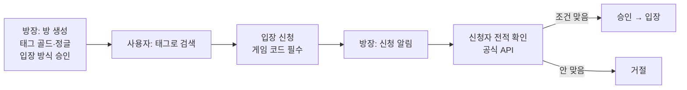
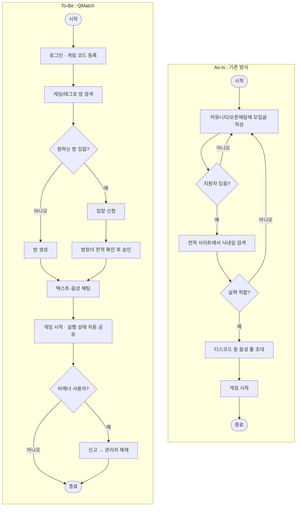

# 1단계. 문제 정의

> 산출물: 프로젝트 제안 · 문제 정의서 · 범위 정의서 · KPI / UML: Activity 다이어그램

## 1.1 프로젝트 개요

| 항목 | 내용 |
|---|---|
| 프로젝트명 | QMatch (큐매치) |
| 형태 | Windows 데스크톱 애플리케이션 (Electron) + Spring Boot 서버 |
| 대상 사용자 | 리그 오브 레전드·메이플스토리·로스트아크·던전앤파이터 플레이어 |
| 개발 기간 | 2025-03-15(저장소 생성) ~ 2025-11-18(최종 기능 병합), 이후 문서 정리 |
| 팀 | 6명 (README 제작자 표 참고) |

## 1.2 문제 정의서

### 현재 상황(As-Is)

같이 게임할 사람을 찾는 과정이 여러 도구로 흩어져 있습니다.

1. **모집** — 커뮤니티 게시판이나 오픈채팅에 글을 올리고 기다린다.
2. **검증** — 상대의 실력(티어·레벨·장비)을 확인하려면 전적 사이트를 따로 열어 닉네임을 검색해야 한다.
3. **소통** — 팀이 꾸려지면 디스코드 같은 별도 음성 툴로 옮겨간다.
4. **관리** — 비매너 사용자를 신고하거나 걸러낼 통합 수단이 없다.

### 핵심 문제

| # | 문제 | 영향 |
|:--:|---|---|
| P1 | 모집·검증·음성 소통이 서로 다른 서비스로 분리됨 | 팀 구성까지 시간이 오래 걸리고 이탈이 많음 |
| P2 | 상대의 게임 실력을 신뢰성 있게 확인하기 어려움 | 실력 차이로 인한 갈등, 허위 정보 |
| P3 | 지금 게임 중인지, 접속 중인지 알 수 없음 | 초대 타이밍을 놓침 |
| P4 | 비매너 사용자에 대한 제재 수단 부재 | 커뮤니티 품질 저하 |

### 목표 상태(To-Be)

하나의 앱 안에서 **게임별 방 검색 → 공식 API 기반 전적 확인 → 방장 승인 → 텍스트·음성 채팅 → 신고·제재**까지 끝나도록 합니다.

| 문제 | 해결 방안 (구현 기능) |
|---|---|
| P1 | 게임·태그별 채팅방 + 방 안의 음성 채널(Agora) |
| P2 | 게임 코드(닉네임) 등록 시 Riot·Nexon·Neople·Smilegate 공식 API로 전적 조회, 게임 코드 없으면 방 생성·입장 불가 |
| P3 | 온라인/자리비움/오프라인 상태 + 실행 중인 게임 프로세스 자동 감지 |
| P4 | 사용자 신고(첨부 이미지) → 관리자 임시/영구 정지 → 강제 로그아웃 |

### 핵심 아이디어: 태그로 조건을 걸고, 전적을 보고 받는다

QMatch 매칭의 중심은 **"방장이 원하는 조건을 태그로 밝히고, 들어오려는 사람의 실제 전적을 확인한 뒤 받아 주는"** 흐름입니다.

1. **조건 명시** — 방장은 방을 만들 때 티어·라인(포지션)·직업 같은 **게임 태그**를 붙여 어떤 팀원을 찾는지 밝힙니다. 예) `골드`, `정글`
2. **승인 방 설정** — 입장 방식을 **방장 승인**으로 정하면 아무나 바로 들어올 수 없습니다.
3. **신청** — 다른 사용자는 태그로 방을 검색해 조건이 맞는 방에 입장을 신청합니다. 신청하려면 해당 게임의 게임 코드(닉네임)가 등록되어 있어야 합니다.
4. **전적 확인 후 결정** — 방장은 신청 알림을 받고, 신청자의 **공식 API 기반 전적**(티어·레벨·장비 등)을 앱 안에서 바로 확인한 뒤 승인하거나 거절합니다.

사용자가 스스로 적는 자기소개가 아니라 게임사 공식 데이터로 실력을 검증하므로, 실력 차이로 인한 갈등과 허위 정보 문제(P2)를 줄입니다.

## 1.3 목표와 KPI

목표치는 기획 단계에서 정한 값이고, **실측** 열은 2026-11 테스트(→ [06-테스트](06-테스트.md))에서 확인한 결과입니다.

| KPI | 정의 | 측정 방법 | 목표 | 실측 |
|---|---|---|---|---|
| 메시지 전달 지연 | 송신 후 다른 클라이언트에 표시되기까지 | k6 부하 테스트, 메시지에 송신 시각을 넣어 수신 시각과 비교 | 1초 이내 | ✅ p95 **50ms** (동시 100명), 59ms (동시 300명) — PT-02·04 |
| API 응답 시간 | 조회 API 응답 시간 | k6 부하 테스트 | p95 500ms 이내 | ✅ p95 **16ms** (동시 200명) / ❌ 566ms (동시 1,000명) — PT-01·03 |
| 동시 접속 처리 | 실패 없이 처리 가능한 동시 사용자 수 | k6 부하 테스트 | 졸업작품 시연 규모(수십 명) | ✅ 조회 1,000명 실패 0% / 채팅 저장은 약 270명부터 실패(BUG-20) — PT-03·04 |
| 상태 반영 지연 | 자리비움·오프라인 전환이 친구 목록에 반영되기까지 | 클라이언트 2대로 확인 | 자리비움 10초 + 전송 1초 이내 | ✅ 10초 무입력 시 자리비움, 앱 종료 시 오프라인 반영 확인 — TC-44·45 |
| 게임 실행 감지 | 게임 실행 후 친구 화면에 표시되기까지 | 클라이언트 2대로 확인 | 10초 이내 | ✅ 리그 오브 레전드 실행 시 표시 확인 — TC-46 |
| 외부 API 재조회 | 같은 캐릭터 재조회 시 캐시 사용 | 수동 확인 | 1시간 캐시 | ✅ 재조회 시 체감상 빨라짐 (수치 미측정) — TC-16 |
| 기능 테스트 통과율 | 수행한 테스트 중 Pass 비율 | 테스트 케이스 52개 | 90% 이상 | ✅ **98%** (Pass 47 / 수행 48, N/A 4 제외) |

## 1.4 범위 정의서

### 포함 범위 (In Scope)

- 회원가입(이메일 인증)·로그인·자동 로그인·아이디/비밀번호 찾기
- 프로필(이미지·소개·상태 메시지·태그·닉네임), 게임 코드 등록과 대표 계정 지정
- 4개 게임 전적 조회: LoL(Riot), 메이플스토리(Nexon Open API), 던전앤파이터(Neople Open API), 로스트아크(Smilegate Lost Ark API)
- 게임별 채팅방: 생성·검색(키워드/게임/태그)·자유 입장/방장 승인·강퇴·방장 위임·설정 변경
- 채팅: 실시간 메시지, 이미지, 링크 미리보기, 이모지, 고정, 삭제, 안 읽은 메시지 수
- 친구: 요청·수락·거절·삭제·차단, 1:1 채팅, 채팅방 초대
- 음성 채팅: 방 안의 음성 채널 생성/삭제, 참여자·발화 표시, 음소거, 장치 설정
- 상태: 온라인/자리비움/오프라인, 게임 실행 감지
- 신고와 관리자 페이지(사용자 조회, 채팅 로그, 정지/영구정지/해제)

### 제외 범위 (Out of Scope)

- 웹·모바일 클라이언트 (Windows 데스크톱만 배포)
- 자동 매칭 알고리즘(실력 기반 자동 팀 편성) — 사용자가 직접 방을 검색·선택
- 결제·유료 기능
- 영상 통화·화면 공유
- 오버워치·발로란트·TFT (아이콘 리소스만 존재, 기능 미구현)

### 제약 사항

| 구분 | 내용 |
|---|---|
| 일정 | 2025년 2학기 졸업작품 발표 일정 |
| 비용 | Agora 무료 사용량, 각 게임사 개발자 API 키(호출량 제한) 범위 내 |
| 기술 | 게임사 API의 호출 제한 → 캐시(Caffeine, 최대 500건·1시간) 적용 |
| 인력 | 학생 6명, 기능 단위로 분담 |

## 1.5 Activity 다이어그램 — 비즈니스 흐름

As-Is(기존 방식)와 To-Be(QMatch)를 비교합니다.

**문제점 시각화**: As-Is는 서비스 3곳을 오가며 "모집 → 검증" 루프를 반복합니다. To-Be는 검증(전적 조회)이 승인 단계에 들어가 있고 음성까지 같은 앱에서 이어집니다.
