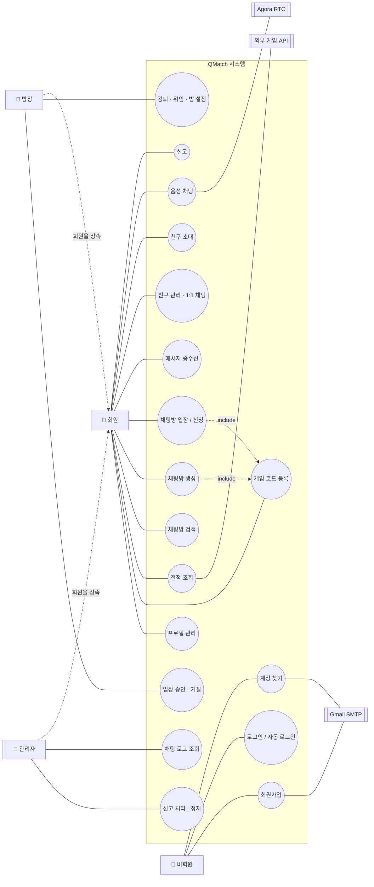

# 2단계. 요구사항

> 산출물: 사용자 스토리 · MoSCoW 우선순위 · 소프트웨어 요구사항 명세서(SRS) · 용어 사전 / UML: Use Case 다이어그램

## 2.1 액터

| 액터 | 설명 |
|---|---|
| 비회원 | 회원가입·로그인·계정 찾기만 가능 |
| 회원 | 로그인한 일반 사용자 (`ROLE_NORMAL`) |
| 방장 | 채팅방을 만든 회원 (`UserChatRoom.role = HOST`) |
| 관리자 | 아이디가 `admin`인 회원 (`ROLE_ADMIN` 부여) |
| 외부 게임 API | Riot / Nexon / Neople / Smilegate |
| Agora | 음성 통신(RTC) 서비스 |
| Gmail SMTP | 인증 메일 발송 |

## 2.2 사용자 스토리

| ID | 사용자 스토리 | 수용 기준 |
|:--:|---|---|
| US-01 | 비회원으로서, 이메일 인증으로 가입하고 싶다. 그래야 내 계정을 안전하게 만들 수 있다. | 6자리 코드 발송, 60초 재발송 제한, 아이디·닉네임 중복 확인 |
| US-02 | 회원으로서, 자동 로그인을 켜고 싶다. 매번 로그인하지 않도록. | remember-me 쿠키 7일 유지 |
| US-03 | 회원으로서, 아이디/비밀번호를 잊었을 때 이메일로 찾고 싶다. | 이메일 인증 후 아이디 표시 / 비밀번호 재설정 |
| US-04 | 회원으로서, 내 게임 닉네임을 등록하고 대표 계정을 정하고 싶다. 그래야 다른 사람이 내 실력을 볼 수 있다. | 게임별 코드 저장·삭제·대표 지정 |
| US-05 | 회원으로서, 다른 사람의 전적을 앱 안에서 보고 싶다. | 4개 게임 전적 모달 표시 |
| US-06 | 회원으로서, 게임·태그·키워드로 방을 찾고 싶다. | 검색 결과에 인원·태그·입장 방식 표시 |
| US-07 | 회원으로서, 방을 만들 때 원하는 팀원 조건(티어·라인 등)을 태그로 밝히고 입장 방식(자유/승인)을 정하고 싶다. 그래야 맞는 사람만 모을 수 있다. | 게임별 태그 선택, 2~20명, 같은 게임 내 방 이름 중복 불가, 게임 코드 필수 |
| US-08 | 방장으로서, 입장 신청자의 전적을 확인한 뒤 승인·거절하고, 문제 사용자를 강퇴하고 싶다. 그래야 실력이 맞는 사람만 받을 수 있다. | 신청 시 실시간 알림, 신청자 전적 조회, 승인 시 인원 +1 |
| US-09 | 방장으로서, 방장 권한을 다른 멤버에게 넘기고 싶다. | 위임 후 실시간 반영 |
| US-10 | 회원으로서, 방에서 텍스트·이미지·이모지로 대화하고 중요한 메시지를 고정하고 싶다. | 이미지 10MB 이하, 고정/삭제 실시간 반영 |
| US-11 | 회원으로서, 안 읽은 메시지가 몇 개인지 알고 싶다. | 방·친구 채팅별 미확인 수 표시 |
| US-12 | 회원으로서, 친구를 추가하고 1:1로 대화하고 싶다. | 요청 수 배지, 수락 시 1:1 방 생성 |
| US-13 | 회원으로서, 친구를 내 방에 초대하고 싶다. | 초대 알림 모달, 수락 시 자동 입장 |
| US-14 | 회원으로서, 방 안에서 음성 채널에 들어가 대화하고 싶다. | 참여자 목록·말하는 사람 표시·음소거 |
| US-15 | 회원으로서, 친구가 접속 중인지·게임 중인지 알고 싶다. | 온라인/자리비움/오프라인 + 실행 중 게임 표시 |
| US-16 | 회원으로서, 비매너 사용자를 증거와 함께 신고하고 싶다. | 사유·상세·첨부 이미지 |
| US-17 | 관리자로서, 신고를 확인하고 사용자를 정지하고 싶다. | 기간 정지/영구 정지/해제, 대상자 즉시 강제 로그아웃 |
| US-18 | 관리자로서, 특정 방의 채팅 로그를 보고 싶다. | 방 ID로 메시지 이력 조회 |

## 2.3 MoSCoW 우선순위

| 구분 | 기능 |
|---|---|
| **Must** | 회원가입·로그인(US-01·02), 게임 코드 등록(US-04), 방 생성·검색·입장(US-06·07), 실시간 텍스트 채팅(US-10), 방장 승인(US-08) |
| **Should** | 전적 조회(US-05), 친구·1:1 채팅(US-12), 음성 채팅(US-14), 접속 상태(US-15), 신고·관리자 제재(US-16·17) |
| **Could** | 계정 찾기(US-03), 방장 위임(US-09), 미확인 메시지 수(US-11), 친구 초대(US-13), 게임 실행 감지, 메시지 고정·링크 미리보기·이모지, 채팅 로그 조회(US-18) |
| **Won't** (이번 범위 제외) | 자동 실력 매칭, 웹·모바일 버전, 영상 통화, 오버워치·발로란트·TFT 연동 |

## 2.4 소프트웨어 요구사항 명세서 (SRS)

### 2.4.1 기능 요구사항

| ID | 분류 | 요구사항 | 관련 API | 우선순위 |
|:--:|---|---|---|:--:|
| FR-01 | 인증 | 아이디 4~20자, 비밀번호 8~16자(대문자·특수문자 포함), 휴대폰 `01X-XXXX-XXXX` 형식을 검증한다 | `POST /api/user/join` | M |
| FR-02 | 인증 | 아이디·닉네임 중복을 확인한다 | `GET /api/user/check-id`, `check-nickname` | M |
| FR-03 | 인증 | 6자리 이메일 인증 코드를 발송하고 60초 안에는 재발송을 막는다 | `POST /api/user/send-email-verification`, `verify-email` | M |
| FR-04 | 인증 | 세션 로그인, 동시 세션 1개(새 로그인 시 기존 세션 만료), remember-me 7일 | `POST /api/loginProc`, `/api/logout` | M |
| FR-05 | 인증 | 정지(SUSPENDED) 기간 중이거나 영구정지(BANNED)면 로그인을 거부하고, 기간이 지나면 자동 해제한다 | `MyUserDetailsService` | S |
| FR-06 | 계정 | 이메일 인증으로 아이디 찾기·비밀번호 재설정 | `POST /api/user/find-id`, `find-password` | C |
| FR-07 | 프로필 | 프로필 이미지·소개·상태 메시지·태그·닉네임 조회/수정 | `/api/profile/*` | S |
| FR-08 | 게임 | 게임 코드 저장·조회·삭제·대표 지정 | `/api/save/gamecode` 외 | M |
| FR-09 | 게임 | LoL(티어·숙련도·최근 전적), 메이플, 던파, 로스트아크 캐릭터 정보를 조회한다 | `/riot`, `/maple/api`, `/dnf`, `/lostark` | S |
| FR-10 | 채팅방 | 방 생성: 인원 2~20, 같은 게임 내 이름 중복 불가, 해당 게임 코드 필수, 생성 시 운영 유의사항 시스템 메시지 | `POST /api/chat/rooms` | M |
| FR-11 | 채팅방 | 키워드·게임·태그 조합 검색 | `GET /api/chat/rooms` | M |
| FR-12 | 채팅방 | 자유 입장(`free`)은 즉시, 승인(`approval`)은 신청 → 방장 승인/거절 | `/join`, `/join-request`, `/approve-join`, `/reject-join` | M |
| FR-13 | 채팅방 | 정원 초과·중복 참여·게임 코드 미등록 시 입장 거부 | `/join` (403/409) | M |
| FR-14 | 채팅방 | 방장: 설정 변경, 강퇴, 위임, 방 삭제 | `PUT /rooms/{id}`, `/kick`, `/transfer`, `DELETE` | S |
| FR-15 | 채팅 | STOMP로 실시간 송수신, DB 저장, 이미지(10MB, image/*만) 전송 | `/app/chat/{roomId}`, `/api/upload/image` | M |
| FR-16 | 채팅 | 메시지 고정·삭제(작성자), 결과를 방 전체에 실시간 반영 | `/messages/{id}/pin`, `DELETE /messages/{id}` | C |
| FR-17 | 채팅 | 방별·친구 채팅별 미확인 메시지 수 | `/api/get/chat/no-read`, `/unread-count` | C |
| FR-18 | 친구 | 요청·수락·거절·삭제·차단, 대기 요청 수 | `/api/friends/*` | S |
| FR-19 | 친구 | 수락 시 1:1 채팅방 생성, 실시간 메시지 | `/app/friends/chat/{roomId}` | S |
| FR-20 | 친구 | 채팅방 초대·수락·거절 | `/api/chat/rooms/invite-friend` 외 | C |
| FR-21 | 음성 | 방별 음성 채널 생성·삭제, Agora 토큰 발급(1시간), 참여자 브로드캐스트 | `/api/voice/channels`, `/agora/token`, `/app/voice/{roomId}/join` | S |
| FR-22 | 상태 | 10초 무입력 시 자리비움, 연결 종료 시 오프라인으로 전파 | `POST /api/user/status`, `/topic/presence` | S |
| FR-23 | 상태 | 10초마다 프로세스 목록을 확인해 4개 게임 실행 여부를 전파 | `/app/status/games/{userId}` | C |
| FR-24 | 신고 | 사유·상세(1000자)·첨부 이미지로 신고 | `POST /api/reports` | S |
| FR-25 | 관리 | 사용자 목록·상세, 신고 목록, 방 채팅 로그 조회 | `/api/admin/*` | S |
| FR-26 | 관리 | 기간 정지·영구 정지·해제, 대상자 세션 즉시 만료 + `force-logout` 알림 | `/api/admin/users/{id}/suspend` 외 | S |

### 2.4.2 비기능 요구사항

| ID | 분류 | 요구사항 | 구현 근거 |
|:--:|---|---|---|
| NFR-01 | 성능 | 채팅·상태 메시지는 실시간(WebSocket)으로 전달한다 | STOMP over SockJS, Simple Broker |
| NFR-02 | 성능 | 외부 게임 API 호출 결과를 캐시해 호출 제한을 피한다 | Caffeine `maximumSize=500, expireAfterWrite=1h` |
| NFR-03 | 보안 | 비밀번호는 BCrypt로 해시 저장한다 | `BCryptPasswordEncoder` |
| NFR-04 | 보안 | 관리자 API는 `ROLE_ADMIN`만 호출 가능하다 | `@PreAuthorize("hasRole('ADMIN')")` |
| NFR-05 | 보안 | API 키·DB 계정·메일 계정은 코드에 넣지 않고 환경 변수로 주입한다 | `application.properties`의 `${...}` |
| NFR-06 | 보안 | 로그인 시 세션 ID를 재발급해 세션 고정 공격을 막는다 | `sessionFixation().changeSessionId()` |
| NFR-07 | 안정성 | WebSocket 끊김 시 5초 간격으로 재연결한다 | `reconnectDelay: 5000` |
| NFR-08 | 사용성 | Windows 설치 파일 하나로 설치하며 설치 경로를 선택할 수 있다 | electron-builder NSIS |
| NFR-09 | 유지보수 | 기능 단위 브랜치(`feature/*`)로 개발하고 `develop`에서 통합한다 | git 브랜치 29개 |
| NFR-10 | 운영 | 클라이언트 로그를 사용자 데이터 폴더에 파일로 남긴다 | `electron-main.log` |

## 2.5 Use Case 다이어그램

Mermaid에는 Use Case 전용 문법이 없어 flowchart로 표현했습니다. 원형 노드가 유스케이스, 사각형이 액터입니다.

## 2.6 용어 사전 (Glossary)

| 용어 | 설명 |
|---|---|
| 게임 코드 | 사용자가 등록한 게임 내 식별자. LoL은 `닉네임#태그`, 그 외는 캐릭터명 (`UserGameCode.gameCode`) |
| 대표 계정 | 게임별로 하나 지정하는 주 계정 (`isMain`) |
| 게임 태그 | 방 검색용 분류값. 예: 라인(탑·정글), 티어, 직업 (`GameTag.category`) |
| 사용자 태그 | 프로필에 붙이는 자유 태그 (`User.userTags`) |
| 자유 입장 / 승인 입장 | 채팅방 `joinType` 값 `free` / `approval` |
| 방장(HOST) / 멤버(MEMBER) | 채팅방 내 역할 (`Role`) |
| 참여 상태 | `PENDING`(대기) · `ACCEPTED`(승인) · `REJECTED`(거절) |
| 친구 상태 | `PENDING` · `ACCEPTED` · `REJECTED` · `BLOCKED`(단방향 차단) · `BLOCKS`(양방향 차단) |
| 계정 상태 | `ACTIVE`(활성) · `SUSPENDED`(임시 정지) · `BANNED`(영구 정지) |
| 접속 상태 | 온라인 · 자리비움(10초 무입력) · 오프라인 |
| 시스템 메시지 | 전송자가 없는 메시지(방 생성 유의사항, 입장 알림) |
| 음성 채널 | 채팅방 안에 만드는 음성 대화 공간. Agora 채널과 1:1 대응 |
| STOMP | WebSocket 위에서 동작하는 메시징 프로토콜. `/app`은 서버로, `/topic`은 구독 |
| SockJS | WebSocket을 쓸 수 없을 때 대체 전송을 제공하는 라이브러리 |
| Agora 토큰 | Agora 채널 입장 권한 토큰. 서버가 App Certificate로 서명, 유효 1시간 |
| remember-me | 브라우저 종료 후에도 로그인을 유지하는 Spring Security 쿠키 (7일) |
| force-logout | 관리자 정지 시 대상자에게 보내는 강제 로그아웃 이벤트 |
