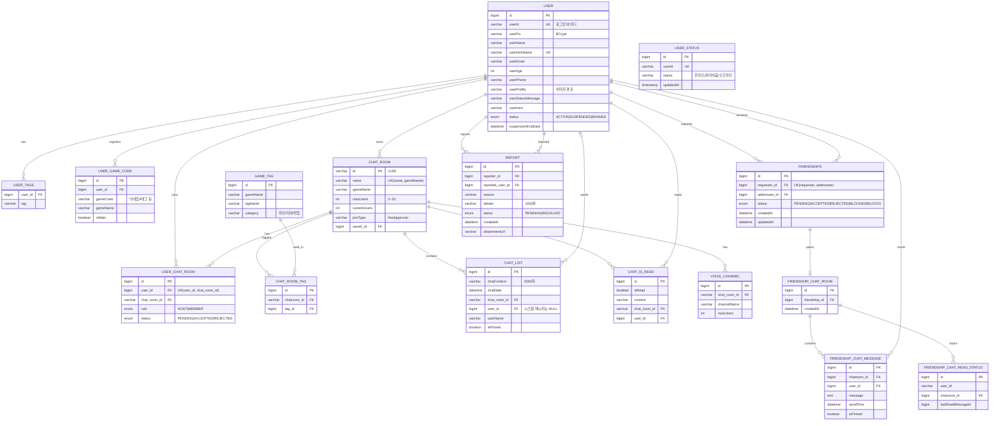
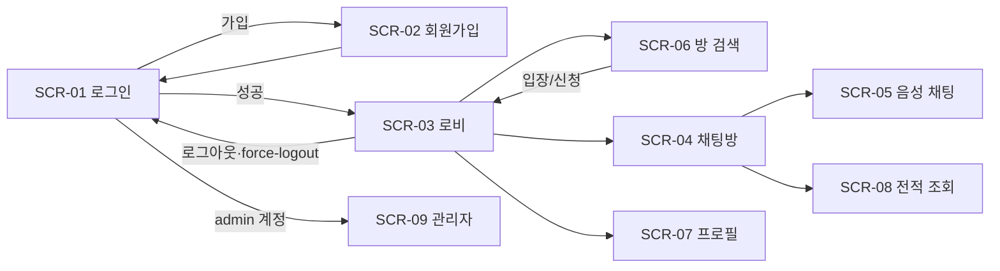
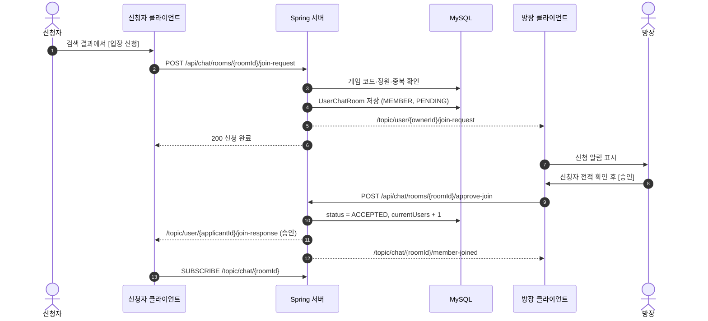
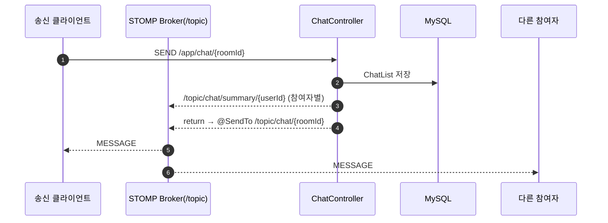
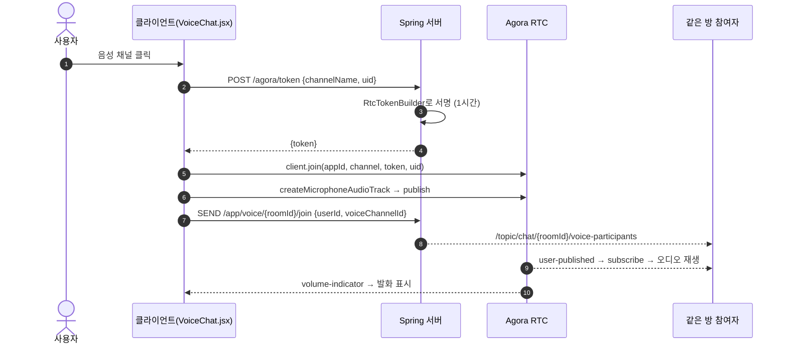
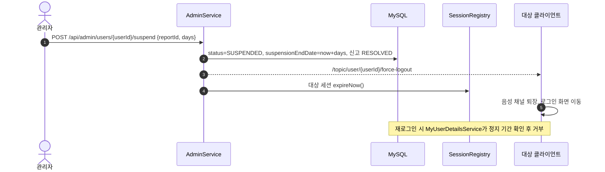
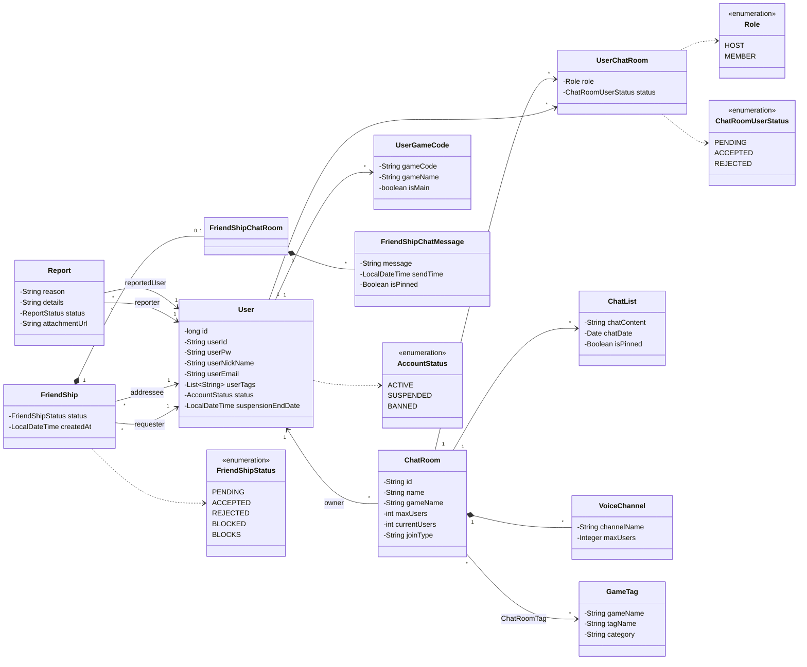
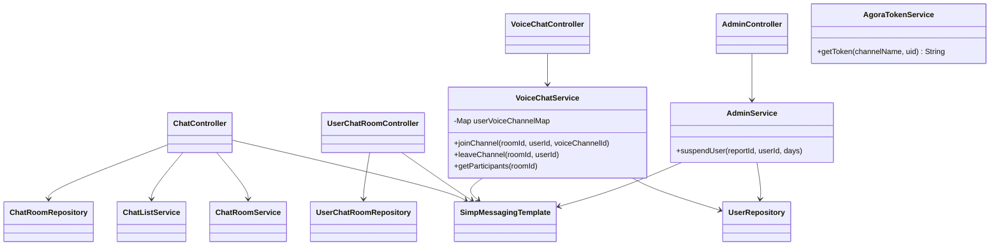

# 3단계. 설계

> 산출물: ERD · API 명세서 · WebSocket 메시지 명세 · 화면/인터페이스 설계서 / UML: Sequence 다이어그램, Class 다이어그램

## 3.1 ERD

JPA 엔티티 15개와 enum 3개(`backend/.../Entity`) 기준입니다. 스키마는 `spring.jpa.hibernate.ddl-auto=update`로 자동 생성되며, remember-me 토큰 테이블 `persistent_logins`는 Spring Security 표준 스키마로 별도 생성합니다.

> `USER_STATUS.userId`는 FK가 아닌 문자열 아이디로 저장됩니다(관계선 없음).

### 테이블 설계 메모

| 테이블 | 키·제약 | 설계 의도 |
|---|---|---|
| `chat_room` | PK가 UUID 문자열, `UNIQUE(name, gameName)` | URL·토픽에 방 ID를 노출해도 추측이 어렵게. 같은 게임 안에서만 이름 중복 금지 |
| `user_chat_room` | `UNIQUE(user_id, chat_room_id)` | 한 사용자가 같은 방에 중복 참여·신청 불가 |
| `friendships` | `UNIQUE(requester_id, addressee_id)` | 같은 방향 친구 요청 중복 방지 |
| `user_status` | `idx_user_status_user` (unique) | 친구 목록 일괄 상태 조회(`/status/batch`) 속도 |
| `chat_list.user_id` | NULL 허용 | 시스템 메시지(유의사항·입장 알림) 저장 |

## 3.2 API 명세서

Base URL은 프론트 환경 변수 `VITE_API_URL`입니다. 인증은 세션 쿠키(`JSESSIONID`) + `remember-me` 쿠키를 씁니다. 별도 표기가 없으면 요청·응답은 JSON입니다.

### 인증·계정 (`UserController`, `AuthController`, Spring Security)

| Method | URL | 파라미터 | 설명 |
|---|---|---|---|
| POST | `/api/loginProc` | form: `username`, `password`, `remember-me` | 로그인. 성공 시 `{message, sessionId}`, 실패 시 401 |
| POST | `/api/logout` | – | 로그아웃, 쿠키 삭제 후 `/logoutOk` |
| GET | `/api/check-login` | – | 세션 로그인 여부 |
| GET | `/api/user/get-data` | – | 로그인 사용자 정보(아이디·닉네임·프로필·태그·권한 등) |
| GET | `/api/user/check-id` | `userId` | 아이디 중복 확인 |
| GET | `/api/user/check-nickname` | `userNickName` | 닉네임 중복 확인 |
| POST | `/api/user/send-email-verification` | `email` | 가입용 인증 코드 발송 (60초 재발송 제한) |
| POST | `/api/user/verify-email` | `email`, `code` | 가입용 코드 확인 |
| POST | `/api/user/send-find-id-verification` | `email` | 아이디 찾기용 코드 발송 |
| POST | `/api/user/send-password-reset-verification` | `userId`, `email` | 비밀번호 재설정용 코드 발송 |
| POST | `/api/user/verify-email-account-recovery` | `email`, `code` | 계정 찾기용 코드 확인 |
| POST | `/api/user/join` | body: `UserRequestDto` | 회원가입 (Bean Validation) |
| POST | `/api/user/find-id` | `email`, `code` | 아이디 찾기 |
| POST | `/api/user/find-password` | `userId`, `email`, `newPassword` | 비밀번호 재설정 (사전 이메일 인증 필요) |

### 프로필·게임 코드·상태

| Method | URL | 파라미터 | 설명 |
|---|---|---|---|
| GET / POST | `/api/profile/user/info` · `/api/profile/image` | `userId` · multipart `file` | 사용자 정보 조회 · 프로필 이미지 업로드 |
| GET / POST | `/api/profile/intro` | `userId` / `{userId, introText}` | 소개글 |
| GET / POST | `/api/profile/status` | `userId` / `{userId, statusMessage}` | 상태 메시지 |
| GET / POST | `/api/profile/usertag` | `userId` / `{userId, userTag}` | 사용자 태그 |
| GET / POST | `/api/profile/usernickname` | `userId` / `{userId, nickName}` | 닉네임 |
| POST | `/api/save/gamecode` | `GameCodeRequestDto` | 게임 코드 저장 |
| GET | `/api/get/user/gamecode` | `userId` | 게임 코드 목록 |
| GET | `/api/get/user/gamedata` | `userId`, `gameName` | 대표 코드로 전적 조회 |
| DELETE | `/api/delete/gamecode/{id}` | – | 게임 코드 삭제 |
| PUT | `/api/user-game-codes/{gameCode}/set-main` | – (로그인 필요) | 대표 계정 지정 |
| GET | `/api/tags/{gameName}` | – | 게임별 태그 목록 |
| POST | `/api/user/status` | `{userId, status}` | 접속 상태 변경 → `/topic/presence` 브로드캐스트 |
| GET | `/api/user/status/batch` | `ids` (목록) | 여러 사용자 상태 일괄 조회 |

### 외부 게임 전적

| Method | URL | 파라미터 | 외부 API |
|---|---|---|---|
| GET | `/riot/stats/by-gamecode` | `gameCode` (`이름#태그`) | Riot Account·Summoner·League·Mastery·Match v5 |
| GET | `/riot/stats/{name}/{tag}` | – | 〃 |
| GET | `/maple/api/character` | `name` | Nexon Open API (캐시 `mapleCache`) |
| GET | `/dnf/stats/by-gamecode` | `gameCode` | Neople Open API |
| GET | `/lostark/api/character/profile` | `name` | Smilegate Lost Ark API (WebClient, 비동기 `Mono`) |

### 채팅방 (`ChatController`, `UserChatRoomController`, `RoomController`)

| Method | URL | 파라미터 | 설명 · 주요 응답 |
|---|---|---|---|
| GET | `/api/chat/rooms` | `keyword?`, `tags?`, `gametag` (`ALL` 또는 게임명) | 방 검색 |
| POST | `/api/chat/rooms` | `{chatName, gameName, tags[], creatorUserId, maxUsers, joinType}` | 방 생성. 400(인원·게임 코드), 409(이름 중복) |
| GET | `/api/chat/rooms/{id}` | – | 방 상세 |
| PUT | `/api/chat/rooms/{roomId}` | 방 설정 | 방장만, 실시간 반영 |
| DELETE | `/api/chat/rooms/{roomId}` | `requesterUserId` | 방 삭제(방장) |
| POST | `/api/chat/rooms/{roomId}/join` | `{userId}` | 자유 입장. 403(승인 방·정원·게임 코드), 409(이미 참여) |
| POST | `/api/chat/rooms/{roomId}/join-request` | body: `RoomJoinRequestDto` | 승인 방 입장 신청 → 방장에게 알림 |
| POST | `/api/chat/rooms/{roomId}/approve-join` | `ownerId`, `applicantId` | 승인 → 신청자에게 `join-response` |
| POST | `/api/chat/rooms/{roomId}/reject-join` | `ownerId`, `applicantId` | 거절 |
| GET | `/api/chat/rooms/{roomId}/pending-requests` | `ownerId` | 대기 중인 신청 목록 |
| GET | `/api/chat/rooms/{roomId}/check-access` | `userId` | 입장 권한 확인 |
| DELETE | `/api/chat/rooms/{roomId}/leave` | `userId` | 방 나가기 |
| POST | `/api/chat/rooms/{roomId}/kick` | `{targetUserId, requesterUserId}` | 강퇴(방장) |
| POST | `/api/chat/rooms/{roomId}/transfer` | `{fromUserId, toUserId}` | 방장 위임 |
| POST | `/api/chat/rooms/{roomId}/apply` · `/accept` · `/reject-apply` | `userId` | 신청/승인/거절 (구버전 흐름, 개인 큐 사용) |
| GET | `/api/chat/rooms/{roomId}/pending` | – | 대기자 목록 (구버전) |
| POST | `/api/add/user/chatroom` | `UserChatRoomRequestDto` | 사용자-방 참여 정보 추가 |
| GET | `/api/get/user/chatrooms` | `userId` | 내가 참여한 방 목록 |
| GET | `/api/get/user/chatlist` | `roomId` | 방 참여자 목록 |
| GET | `/api/chat/active-users/{roomId}` | – | 현재 접속 중인 참여자 |

### 메시지

| Method | URL | 설명 |
|---|---|---|
| GET | `/api/user/request/userchatlist?roomId=` | 방 메시지 이력 |
| POST | `/api/user/add/userchatlist` | 메시지 저장 |
| PUT | `/api/chat/rooms/{roomId}/messages/{messageId}/pin` | 저장된 메시지 고정 토글 |
| PUT | `/api/chat/rooms/{roomId}/realtime-messages/pin` | 방금 보낸(아직 ID 없는) 메시지 고정 |
| DELETE | `/api/chat/rooms/{roomId}/messages/{messageId}?userId=` | 메시지 삭제(작성자) |
| DELETE | `/api/chat/rooms/{roomId}/realtime-messages` | 실시간 메시지 삭제 |
| POST | `/api/upload/image` | 채팅 이미지 업로드 (로그인 필요, image/*, 10MB 이하) |
| POST | `/api/chat/isread` · `/api/chat/read` | 읽음 처리 |
| GET | `/api/get/chat/no-read` | 미확인 메시지 수 |

### 친구

| Method | URL | 파라미터 | 설명 |
|---|---|---|---|
| POST | `/api/friends/request` | `requesterId`, `addresseeId` | 친구 요청 |
| POST | `/api/friends/accept` · `/reject` | `responseId`, `userId` | 수락(1:1 방 생성) · 거절 |
| POST | `/api/friends/delete` | `requesterId`, `addresseeId` | 삭제 |
| POST | `/api/friends/block` | `requesterId`, `blockedId` | 차단 |
| GET | `/api/friends/list` | `userId` | 친구 목록 |
| GET | `/api/friends/inventory` | `userId`, `bottomToggle` | 받은/보낸 요청함 |
| GET | `/api/friends/pending-count` | `userId` | 대기 요청 수 |
| GET | `/api/friends/chatroom/{friendId}/{userId}` | – | 1:1 방 ID 조회 |
| GET | `/api/friends/chatroom/{roomId}/messages` | – | 1:1 메시지 이력 |
| PUT / DELETE | `/api/friends/chatroom/{roomId}/messages/{messageId}[/pin]` | `userId` | 고정 · 삭제 |
| POST | `/api/friends/chatroom/{roomId}/read` | `userId`, `lastReadMessageId` | 읽음 처리 |
| GET | `/api/friends/chatroom/{roomId}/unread-count` | `userId` | 미확인 수 |
| POST | `/api/chat/rooms/invite-friend` · `accept-invite` · `reject-invite` | body | 채팅방 초대 흐름 |

### 음성 채팅

| Method | URL | 설명 |
|---|---|---|
| POST | `/agora/token` | `{channelName, uid}` → `{token}` (Publisher 권한, 1시간) |
| GET | `/api/voice/channels/{chatRoomId}` | 방의 음성 채널 목록 |
| POST | `/api/voice/channels` | 음성 채널 생성 |
| DELETE | `/api/voice/channels/delete/{channelId}` | 음성 채널 삭제 → `/topic/voice/channel-deleted` |
| GET | `/api/voice/participants/{roomId}[/{voiceChannelId}]` | 참여자 목록 |

### 신고·관리자 (모두 `ROLE_ADMIN`, 신고 작성 제외)

| Method | URL | 설명 |
|---|---|---|
| POST | `/api/reports` | 신고 작성 (multipart, 첨부 이미지) |
| GET | `/api/admin/users` · `/api/admin/users/{userId}` | 사용자 목록 · 상세 |
| GET | `/api/admin/reports` | 신고 목록 |
| GET | `/api/admin/chat-logs/{roomId}` | 방 채팅 로그 |
| POST | `/api/admin/users/{userId}/suspend` | `{reportId, days}` 기간 정지 (`days ≥ 9999`는 영구) |
| POST | `/api/admin/users/{userId}/ban` | 영구 정지 |
| POST | `/api/admin/users/{userId}/activate` | 정지 해제 |

## 3.3 WebSocket(STOMP) 메시지 명세

- 엔드포인트: `{BASE_URL}/gs-guide-websocket` (SockJS)
- 송신 prefix: `/app`, 구독 prefix: `/topic` (Simple Broker), 개인 큐: `/user/queue/*`

### 클라이언트 → 서버 (`/app/...`)

| Destination | Payload | 처리 |
|---|---|---|
| `/app/chat/{roomId}` | `{userId, name, message, type, ...}` | 저장 후 `/topic/chat/{roomId}`, 참여자별 `/topic/chat/summary/{userId}` |
| `/app/friends/chat/{roomId}` | `FriendChatMessageRequestDto` | 저장 후 `/topic/friends/chat/{roomId}` |
| `/app/voice/{roomId}/join` | `{userId, voiceChannelId}` | 참여자 맵 갱신 후 브로드캐스트 |
| `/app/voice/{roomId}/leave` | `{userId}` | 〃 |
| `/app/status/games/{userId}` | `{userId, runningGames[]}` | `/topic/status/games` |

### 서버 → 클라이언트 (구독 토픽)

| Topic | 발생 시점 |
|---|---|
| `/topic/chat/{roomId}` | 메시지, 시스템 메시지, 고정·삭제 결과 |
| `/topic/chat/{roomId}/member-joined` · `/leave` · `/kick` · `/accept` | 멤버 입장·퇴장·강퇴·승인 |
| `/topic/chat/{roomId}/voice-participants` | 방 음성 참여자 변경 |
| `/topic/chat/summary/{userId}` | 내 방 목록의 마지막 메시지·미확인 갱신 |
| `/topic/room/{roomId}/join-request` | 입장 신청 발생 |
| `/topic/user/{userId}/join-request` · `/join-response` | 방장에게 신청 알림 · 신청자에게 결과 |
| `/topic/user/{userId}/friend-invite` · `/friend-invite-response` | 친구 초대 · 응답 |
| `/topic/user/{userId}/force-logout` | 관리자 정지 시 강제 로그아웃 |
| `/topic/friends/{userId}` | 친구 요청·수락·삭제 이벤트 |
| `/topic/friends/chat/{roomId}` · `/topic/friends/unread/{userId}` | 1:1 메시지 · 미확인 수 |
| `/topic/presence` · `/topic/friends/status` | 접속 상태 변경(연결 해제 시 오프라인 포함) |
| `/topic/status/games` | 게임 실행 상태 |
| `/topic/voice-participants` · `/topic/voice/channel-deleted` | 전체 음성 참여자 · 채널 삭제 |

## 3.4 화면 / 인터페이스 설계서

| 화면 ID | 화면 | 파일 | 주요 구성 | 데이터 흐름 |
|:--:|---|---|---|---|
| SCR-01 | 로그인 | `route/loginPage/loginPage.jsx`, `loginRoutePage.jsx` | 아이디·비밀번호, 자동 로그인 체크, 아이디/비밀번호 찾기 모달 | `POST /api/loginProc` → `get-data` → 로비 |
| SCR-02 | 회원가입 | `signupRoutePage.jsx` | 중복 확인 버튼, 이메일 인증, 입력 검증 | `check-id/nickname` → `send/verify-email` → `join` |
| SCR-03 | 로비 | `route/lobbyPage/lobbyPage.jsx` | 좌: 참여 방 목록·친구 목록, 중: 채팅방, 우: 참여자·음성 채널 | `get/user/chatrooms`, STOMP 구독 |
| SCR-04 | 채팅방 | `ChatRoom.jsx`, `MessageList.jsx` | 메시지 목록, 고정 메시지, 입력창(이미지·이모지), 우클릭 메뉴 | `/app/chat/{id}` ↔ `/topic/chat/{id}` |
| SCR-05 | 음성 채팅 | `lobbyPageRoute/VoiceChat.jsx` | 채널 목록, 참여자·발화 표시, 음소거 | `/agora/token` → Agora join → `/app/voice/*` |
| SCR-06 | 방 검색 | `route/searchPage/searchPage.jsx` | 게임 탭, 태그 필터, 키워드, 방 카드 | `GET /api/chat/rooms` |
| SCR-07 | 내 프로필 | `feature/profile/myProfileModal.jsx` | 이미지·소개·상태 메시지·태그·게임 코드 | `/api/profile/*`, `/api/save/gamecode` |
| SCR-08 | 전적 조회 | `modal/userHistory/*Page.jsx` | 게임별(LoL·메이플·던파·로아) 전적 | `/riot`, `/maple`, `/dnf`, `/lostark` |
| SCR-09 | 관리자 | `feature/admin/adminPage.jsx` | 사용자 목록, 신고 목록, 상세·정지 모달, 채팅 로그 | `/api/admin/*` |
| MOD-01~ | 모달 | `modal/*` | 방 생성·설정·입장 신청·친구 초대/삭제/알림·신고·음성 설정 | 각 API |

화면 전환:

## 3.5 Sequence 다이어그램

### (1) 승인 방 입장 신청 → 방장 승인

### (2) 실시간 메시지 전송

### (3) 음성 채널 입장

### (4) 관리자 정지 → 강제 로그아웃

## 3.6 Class 다이어그램 (도메인 핵심)

서비스 계층 의존 관계(요약):

