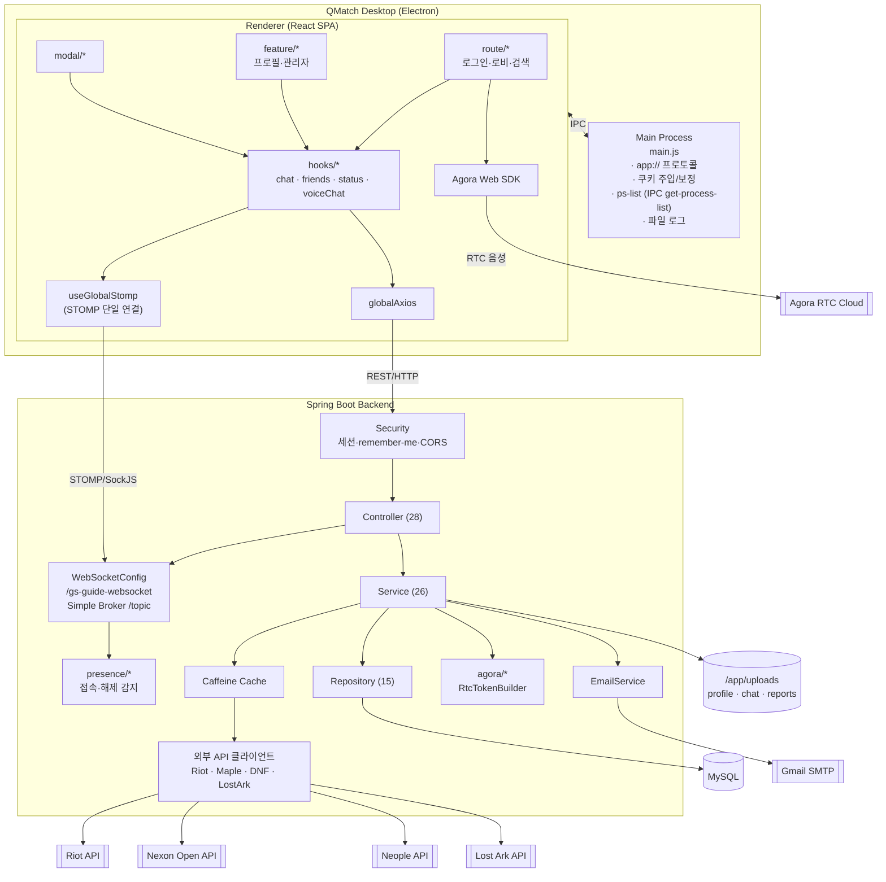
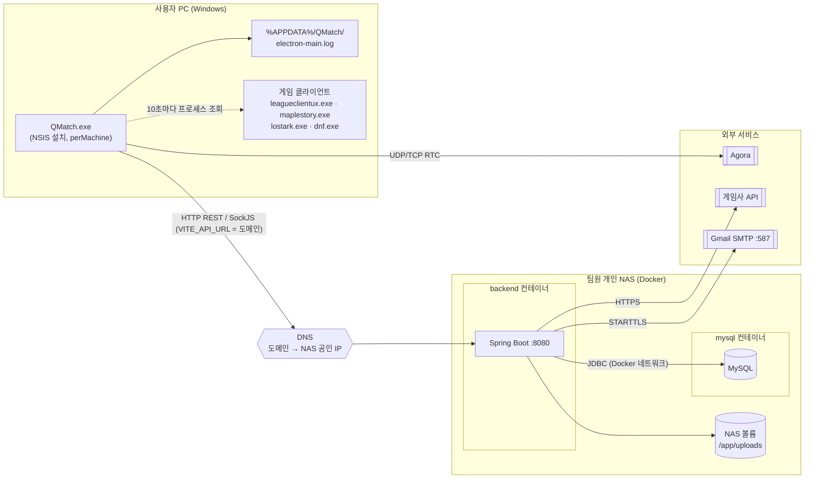
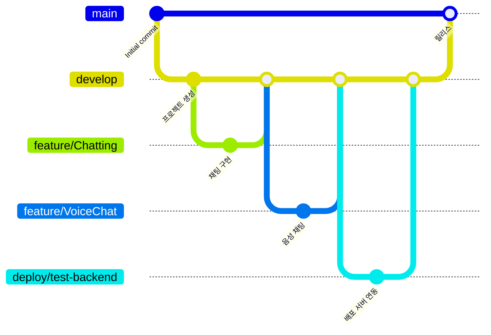

# 4단계. 구조 생성

> 산출물: 소프트웨어 아키텍처 정의서 · 인프라 구성도 · 코딩 규칙과 협업 가이드 / UML: Component 다이어그램, Deployment 다이어그램

## 4.1 아키텍처 정의서

### 아키텍처 스타일

**클라이언트-서버 + 이벤트 기반 실시간 메시징** 구조입니다.

- **클라이언트**: Electron 데스크톱 앱 안에서 React SPA가 동작합니다. Electron 메인 프로세스는 로컬 프로세스 목록(게임 실행 감지)과 쿠키 관리를 맡고, 렌더러(React)는 IPC로 요청합니다.
- **서버**: Spring Boot 단일 애플리케이션(모놀리식)이며, 계층은 `Controller → Service → Repository → Entity`입니다.
- **통신**: 요청/응답은 REST(axios), 실시간 이벤트는 STOMP over SockJS, 음성은 클라이언트끼리 Agora RTC로 직접 주고받습니다(서버는 토큰 발급과 참여자 목록만 관리).
- **외부 연동**: 게임사 Open API 4종은 서버에서만 호출해 API 키가 클라이언트에 노출되지 않게 합니다.

### 아키텍처 결정 기록 (ADR)

| # | 결정 | 이유 | 대안·트레이드오프 |
|:--:|---|---|---|
| AD-1 | 웹 대신 **Electron 데스크톱 앱** | 게임 실행 프로세스를 감지하려면 OS 프로세스 목록 접근이 필요 (`ps-list`) | 설치 필요, 쿠키·CORS 처리가 복잡해짐 → `app://` 프로토콜과 쿠키 수동 주입으로 해결 |
| AD-2 | **세션 + remember-me** 인증 (JWT 미사용) | Spring Security 기본 기능으로 중복 로그인 차단·강제 만료를 쉽게 구현 | 서버 확장 시 세션 공유가 필요(현재 단일 서버) |
| AD-3 | **STOMP Simple Broker** | 별도 브로커 없이 토픽 기반 Pub/Sub, 개발 속도 | 서버를 여러 대 두면 RabbitMQ 등 외부 브로커로 바꿔야 함 |
| AD-4 | 음성은 **Agora RTC** | WebRTC 시그널링·TURN 서버를 직접 운영하지 않아도 됨 | 외부 서비스 의존, 무료 사용량 제한 |
| AD-5 | 외부 API 결과 **Caffeine 캐시** | 게임사 API 호출 제한 회피, 응답 속도 | 1시간 동안 최신 전적이 반영되지 않을 수 있음 |
| AD-6 | 음성 참여자·접속 사용자는 **메모리(ConcurrentHashMap)** 보관 | 자주 바뀌는 휘발성 데이터라 DB 부하를 줄임 | 서버 재시작 시 초기화 |
| AD-7 | 채팅방 PK는 **UUID 문자열** | 토픽 경로에 방 ID가 노출되므로 순차 ID 추측 방지 | 인덱스 크기 증가 |
| AD-8 | 서버를 **팀원 개인 NAS**에 Docker로 배포 | 클라우드 비용 없이 상시 서버 확보, 팀이 직접 관리 가능 | 가정용 회선·전원에 의존, 도메인·포트 개방 관리 필요 |

## 4.2 기술 스택

| 영역 | 기술 | 버전 | 용도 |
|---|---|---|---|
| 언어 | Java | 21 | 백엔드 |
| 프레임워크 | Spring Boot | 3.4.5 | Web, Data JPA, Security, WebSocket, WebFlux(WebClient), Cache, Validation, Mail |
| DB | MySQL | – | `mysql-connector-j` |
| 캐시 | Caffeine | Boot 관리 | 외부 API 응답 캐시 |
| 빌드 | Gradle | wrapper | `qmatch-0.0.23` |
| UI | React | 19 | SPA |
| 번들러 | Vite | 6 | 개발 서버·빌드 |
| 데스크톱 | Electron / electron-builder | 35 / 26 | 앱 셸, NSIS 설치 파일 |
| 실시간 | @stomp/stompjs + sockjs-client | 7 / 1.6 | STOMP 클라이언트 |
| 음성 | agora-rtc-sdk-ng | 4.24 | 음성 통화 |
| HTTP | axios | 1.9 | REST 호출 (`withCredentials`) |
| 기타 | react-router-dom 7, react-toastify, react-tooltip, react-icons, ps-list | – | 라우팅·알림·툴팁·아이콘·프로세스 목록 |

### PoC / Prototype / MVP 경과 (git 이력 기준)

| 단계 | 시기 | 내용 |
|---|---|---|
| PoC | 2025-05 | 프로젝트 생성, 채팅(STOMP)·게임 API 호출 가능성 확인 |
| Prototype | 2025-06 ~ 08 | `feature/Chatting`, `ChatRoom`, `Tag`, `LOLPage` 등 화면·흐름 구현 |
| MVP | 2025-09 ~ 10 | 커밋 집중(9월 151건). 친구·음성·상태·관리자·승인 입장 통합 |
| Pilot | 2025-11 | 자동 로그인, 강제 로그아웃, 배포 백엔드(`deploy/test-backend`) 연동, UI 마감 |

## 4.3 Component 다이어그램

## 4.4 Deployment 다이어그램

백엔드와 DB는 **팀원 개인 NAS 서버**에 Docker 컨테이너로 올려 운영했습니다. 별도 클라우드 비용 없이 시연·테스트 기간 동안 상시 서버를 확보하기 위한 선택입니다.

| 항목 | 내용 |
|---|---|
| 호스트 | 팀원 개인 NAS |
| 실행 방식 | Docker 컨테이너 (백엔드, MySQL) |
| DB | MySQL — 같은 NAS의 Docker 컨테이너 |
| 파일 저장 | 컨테이너 내부 `/app/uploads` (NAS 볼륨 마운트) |
| 외부 접속 | 도메인(DNS) 주소로 접속 — 클라이언트 `VITE_API_URL`에 도메인 지정 |

### 환경 변수

| 위치 | 키 | 설명 |
|---|---|---|
| 백엔드 | `spring.datasource.url / username / password` | MySQL 접속 정보 |
| 백엔드 | `dnf.api-key`, `riot.api-key`, `maple.api.key`, `lostark.api-key`, `lostark.base-url` | 게임사 API |
| 백엔드 | `agora_id`, `agora_certificate` | Agora App ID / Certificate |
| 백엔드 | `front_url` | CORS 허용 배포 주소 |
| 백엔드 | `spring.mail.username / password` | Gmail 계정·앱 비밀번호 |
| 백엔드 | `upload.path` | 프로필 이미지 저장 경로 (기본 `/app/uploads/profile`) |
| 프론트 | `VITE_API_URL` | 백엔드 주소 (REST·SockJS 공통) |
| 프론트 | `VITE_AGORA_APP_ID` | Agora App ID |
| Electron | `FRONT_DOMAIN` | 메인 프로세스에서 쓰는 도메인 |

## 4.5 CI/CD 현황

현재 저장소에는 CI/CD 파이프라인(GitHub Actions, Jenkins 등)이 **없습니다**. 빌드·배포는 수동입니다.

| 단계 | 현재 방식 |
|---|---|
| 통합 | `feature/*` → `develop` 수동 병합(병합 커밋 110건), 이후 `main` |
| 백엔드 빌드 | `./gradlew build` → Docker 이미지로 만들어 NAS에서 컨테이너 실행 |
| 프론트 배포 | `npm run dist` → `dist/QMatch Setup x.x.x.exe`를 GitHub Releases에 업로드 |

개선안은 [07-수정및문서화 › 백로그](07-수정및문서화.md#73-개선-백로그)에 정리했습니다.

## 4.6 코딩 규칙 (코드에서 확인된 컨벤션)

| 대상 | 규칙 | 예시 |
|---|---|---|
| 백엔드 패키지 | 계층별 폴더, 대문자 시작 | `Controller`, `Service`, `Repository`, `Entity`, `Dto/Request`, `Dto/Response` |
| 클래스 | PascalCase + 역할 접미사 | `ChatRoomService`, `FriendShipRepository`, `UserRequestDto` |
| 메서드·변수 | camelCase | `joinChannel`, `currentUsers` |
| DTO | 요청 `*RequestDto`, 응답 `*ResponseDto` 분리 | `ChatRoomRequestDto`, `FriendShipResponseDto` |
| 상수 | 별도 클래스, UPPER_SNAKE | `ChatConstants.WELCOME_MESSAGE` |
| 엔티티 | Lombok `@Getter/@Setter`, enum은 `@Enumerated(STRING)` | `AccountStatus`, `Role` |
| 검증 | 입력 검증은 DTO에 Bean Validation | `@Size`, `@Pattern` |
| 프론트 컴포넌트 | PascalCase `.jsx` + 같은 이름 `.css` | `CreateRoomModal.jsx` / `.css` |
| 프론트 훅 | `use` 접두사, 도메인별 폴더 | `hooks/chat/useChatSender.js` |
| HTTP | 공통 axios 인스턴스 사용 | `api/globalAxios.js` |
| 주석 | 한국어 주석으로 의도 설명 | – |

> 일부 파일은 규칙에서 벗어납니다(`userProfileController`, `userBlock.js`, `dropDownPotal.jsx`). [백로그](07-수정및문서화.md#73-개선-백로그)에 정리 항목으로 넣었습니다.

## 4.7 협업 가이드 · Git 브랜치 전략

Git Flow를 단순화한 방식입니다.

| 브랜치 | 용도 | 실제 예 |
|---|---|---|
| `main` | 배포·제출 기준 | – |
| `develop` | 기능 통합 | 날짜별 병합 커밋 (`2025-11-18 develop 병합`) |
| `feature/<기능>` | 기능 단위 개발 | `Admin`, `VoiceChat`, `FriendShip`, `EmailPass`, `LOLPage` 등 25개 |
| `deploy/<대상>` | 배포 환경 설정 | `deploy/test-backend`, `deploy/autologin` |

규칙:

1. 기능을 시작할 때 `develop`에서 `feature/<기능명>`(PascalCase)으로 분기합니다.
2. 작업 전 `develop`을 pull해 충돌을 줄입니다.
3. 커밋 메시지는 한국어로 "무엇을 했는지" 씁니다. 예: `자동 로그아웃시 통화 종료, 재로그인시 스톰프 구독 로직 추가`
4. 병합 충돌은 담당자가 해결하고 `충돌 해결` 커밋을 남깁니다.
5. API 키·DB 비밀번호는 커밋하지 않습니다(`application.properties`는 `${...}` 자리표시자, 프론트 `.env`는 `.gitignore`).
