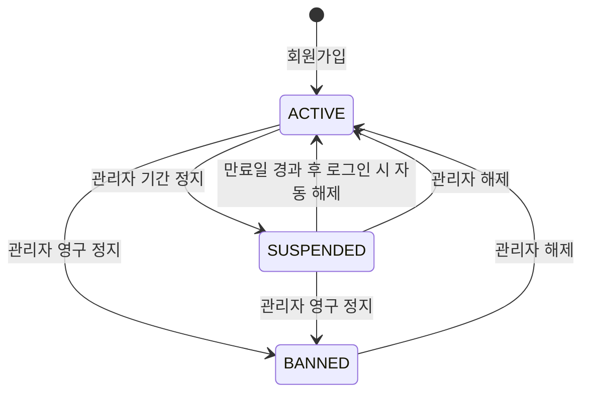
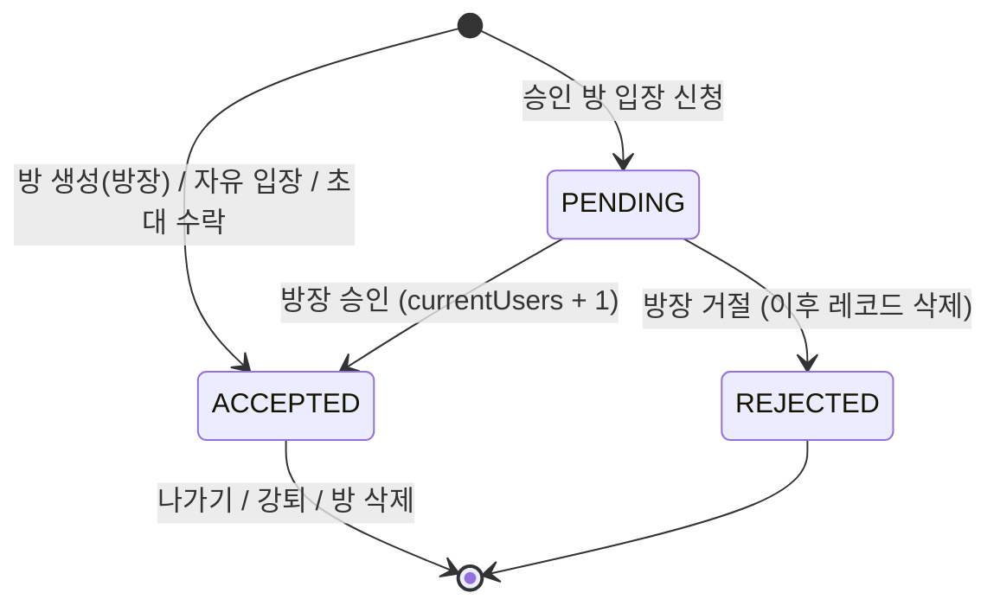
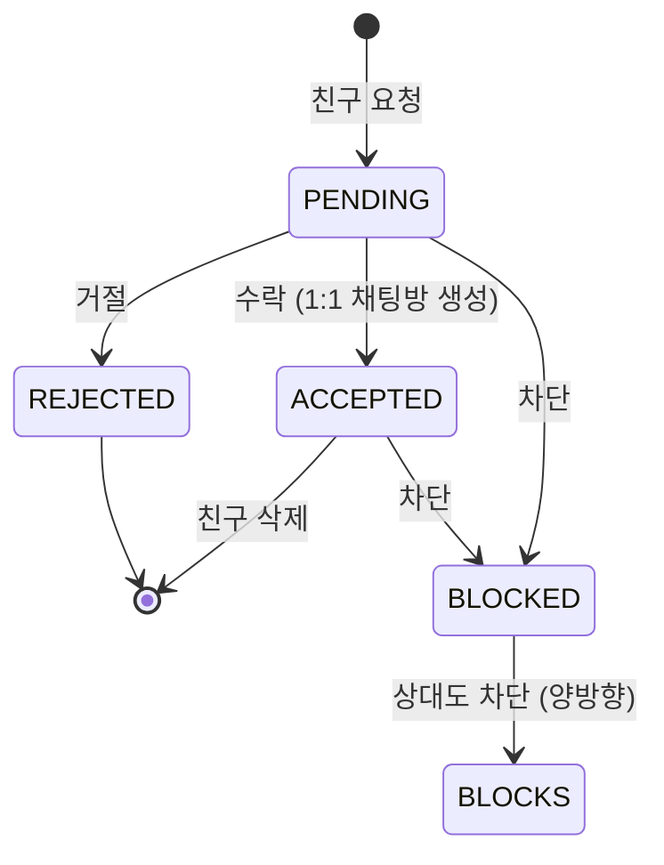
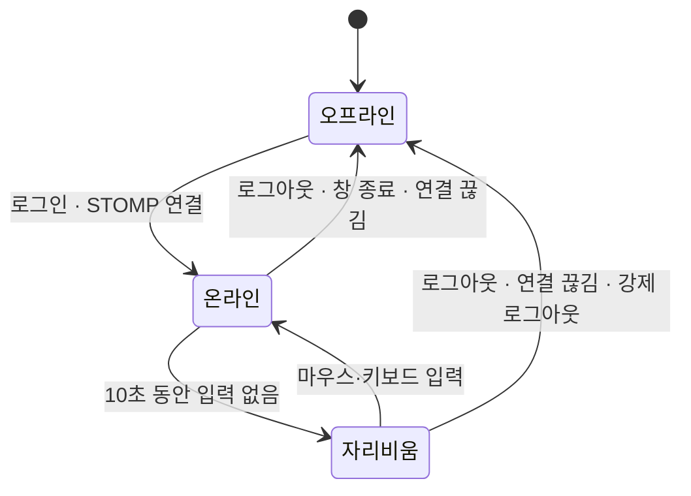

# 5단계. 구현

> 산출물: 소스 코드 구조 · 핵심 로직 설명 · API 상세 명세(→ [03-설계](03-설계.md#32-api-명세서)) · 빌드/배포 스크립트 / UML: State 다이어그램

## 5.1 소스 코드 구조

```text
QMatch/
├── backend/                         Spring Boot (Gradle)
│   └── src/main/java/com/example/backend/
│       ├── BackendApplication.java
│       ├── agora/                   Agora 토큰 생성기 (공식 샘플 이식)
│       ├── Config/                  캐시, WebClient(게임 API), 정적 리소스
│       ├── Constants/               ChatConstants (시스템 메시지)
│       ├── Controller/              REST + STOMP @MessageMapping (28)
│       ├── Dto/ (Request, Response) 요청·응답 객체
│       ├── Entity/                  JPA 엔티티·enum (18)
│       ├── enums/                   ChatRoomUserStatus, FriendShipStatus
│       ├── Init/                    GameTagInitializer (게임 태그 초기 데이터)
│       ├── presence/                STOMP 접속/해제 감지 → 오프라인 전파
│       ├── Repository/              Spring Data JPA (15)
│       ├── Security/                SecurityConfig, CookieConfig, UserDetailsService
│       ├── Service/                 비즈니스 로직 (26)
│       └── Websocket/               WebSocketConfig, RealTimeUserManagement
├── frontend/                        React + Vite + Electron
│   ├── main.js                      Electron 메인 프로세스
│   ├── assets/icon.ico              설치 아이콘
│   ├── public/                      게임·티어 아이콘, 로고
│   └── src/
│       ├── App.jsx                  라우팅, 전역 STOMP, 게임 감지, 자동 로그아웃
│       ├── api/globalAxios.js       공통 axios (Electron 쿠키 주입)
│       ├── route/                   loginPage · lobbyPage · searchPage
│       ├── feature/                 admin · profile
│       ├── modal/                   방 생성·설정, 친구, 신고, 음성 설정, 전적 등
│       ├── components/              이모지, 이미지, 링크 미리보기, 우클릭 메뉴
│       └── hooks/                   chat · chatList · chatNotice · friends · login · status · stomp · voiceChat
├── uploads/                         업로드 파일 (profile, reports)
└── img/                             README 이미지
```

## 5.2 핵심 로직

### (1) 인증 · 세션 (`SecurityConfig`, `MyUserDetailsService`)

- 폼 로그인 처리 URL은 `/api/loginProc`입니다. 성공 시 HTML 리다이렉트 대신 JSON(`sessionId` 포함)을 돌려줘 Electron이 처리할 수 있게 했습니다.
- `maximumSessions(1)` + `maxSessionsPreventsLogin(false)`: 다른 곳에서 로그인하면 기존 세션이 만료됩니다.
- remember-me 토큰은 `JdbcTokenRepositoryImpl`로 DB에 저장(7일)합니다.
- `loadUserByUsername`에서 계정 상태를 검사합니다. `BANNED`면 거부, `SUSPENDED`면 만료일 전에는 거부하고 지났으면 `ACTIVE`로 되돌립니다. 아이디가 `admin`이면 `ROLE_ADMIN`을 추가로 부여합니다.

### (2) Electron 쿠키 처리 (`main.js`, `globalAxios.js`)

패키징된 앱은 `app://index.html`에서 로드되므로 백엔드(`http://...`)와 출처가 달라 쿠키가 자동으로 붙지 않습니다. 이를 위해:

1. `onHeadersReceived`에서 `Set-Cookie`를 가로채 `SameSite=None`으로 바꾸고 `Secure`·`Domain`을 제거한 뒤 Electron 쿠키 저장소에 직접 저장합니다(remember-me는 만료일이 없으면 7일로 지정).
2. `onBeforeSendHeaders`에서 저장된 쿠키를 모든 요청 헤더에 주입합니다.
3. 렌더러는 IPC(`get-cookies`, `set-cookies`)로 쿠키를 읽고 씁니다.

### (3) 채팅방 생성 · 입장 (`ChatController`)

방 생성 검증 순서: 인원 2~20 → 생성자 존재 → 같은 게임 내 이름 중복(409) → 해당 게임 코드 등록 여부 → UUID로 방 생성 → 방장 `UserChatRoom(HOST, ACCEPTED)` 저장 → 태그 연결 → 운영 유의사항 시스템 메시지 전송·저장.

자유 입장(`/join`) 검증 순서: 중복 참여(409) → `joinType == free`(아니면 403) → 정원(403) → 게임 코드(403) → `MEMBER, ACCEPTED` 저장, `currentUsers + 1` → 입장 시스템 메시지 → `member-joined` 브로드캐스트. 메서드에 `@Transactional`을 걸어 인원 수와 참여 정보가 함께 저장되게 했습니다.

### (4) 접속 상태 (`useUserStatusReporter`, `presence/*`)

- 클라이언트가 `mousemove`·`keydown`으로 마지막 활동 시각을 기록하고, 1초마다 확인해 10초 넘게 입력이 없으면 `자리비움`, 있으면 `온라인`으로 바꿔 `POST /api/user/status`를 보냅니다(바뀔 때만).
- 서버는 `/topic/presence`와 `/topic/friends/status`로 전파합니다.
- STOMP 연결이 끊기면 `StompDisconnectListener`가 해당 사용자를 `오프라인`으로 전파합니다.

### (5) 게임 실행 감지 (`App.jsx`, `useGameStatus`)

10초마다 IPC `get-process-list`로 프로세스 목록을 받아 4개 실행 파일(`leagueclientux.exe`, `maplestory.exe`, `lostark.exe`, `dnf.exe`)과 비교합니다. 이전에 보낸 값과 다를 때만 `/app/status/games/{userId}`로 보내고, 모든 클라이언트는 `/topic/status/games`를 구독해 친구 목록에 표시합니다.

### (6) 음성 채팅 (`VoiceChat.jsx`, `VoiceChatService`)

- 클라이언트가 `/agora/token`으로 토큰을 받아 Agora 채널에 입장하고 마이크 트랙을 publish합니다.
- 다른 사용자가 `user-published`되면 subscribe해 오디오를 재생합니다.
- `volume-indicator` 이벤트로 말하는 사람을 강조합니다(`useSpeakingIndicator`).
- 음소거는 트랙 `setEnabled(false)`로 처리합니다.
- 서버는 `userId → {roomId, voiceChannelId, 닉네임}`을 `ConcurrentHashMap`에 보관하고 변경 시 방 토픽과 전역 토픽으로 참여자 목록을 브로드캐스트합니다.
- 자동 로그아웃·강제 로그아웃 시 음성 채널에서도 나가고, 재로그인하면 STOMP 구독을 다시 등록합니다(커밋 `f930f2c`).

### (7) 외부 게임 API · 캐시

- Riot: Riot ID → PUUID → 소환사·리그·숙련도·최근 매치(v5)를 차례로 조회합니다.
- 메이플: Nexon Open API, `@Cacheable("mapleCache")`.
- 던파: Neople Open API (`/df/servers/...`).
- 로스트아크: WebClient로 비동기(`Mono`) 호출합니다.
- 캐시 정책: Caffeine `maximumSize=500, expireAfterWrite=1h`.

### (8) 신고 · 제재 (`ReportService`, `AdminService`)

신고 시 첨부 이미지는 `타임스탬프_원본파일명`으로 저장합니다. 관리자가 정지하면 `suspensionEndDate = now + days`(9999일 이상은 영구정지 문구), 신고는 `RESOLVED`로 바뀌고, 대상에게 `/topic/user/{id}/force-logout`을 보낸 뒤 `SessionRegistry`로 세션을 즉시 만료합니다.

## 5.3 State 다이어그램

### 계정 상태 (`AccountStatus`)



### 채팅방 참여 상태 (`UserChatRoom.status`)



### 친구 관계 (`FriendShipStatus`)



### 접속 상태 (클라이언트)



## 5.4 빌드 · 실행 · 배포 스크립트

### 백엔드

```bash
cd backend
# 환경 변수(DB, API 키, Agora, front_url, 메일) 설정 후
./gradlew bootRun          # 개발 실행 (:8080)
./gradlew build            # build/libs/*.jar 생성
java -jar build/libs/backend-qmatch-0.0.23.jar
```

### 프론트엔드

```bash
cd frontend
npm install
# .env 에 VITE_API_URL, VITE_AGORA_APP_ID, FRONT_DOMAIN 작성
npm run dev        # Vite(5173) + Electron 동시 실행 (concurrently, wait-on)
npm run dist       # vite build → electron-builder → dist/QMatch Setup x.x.x.exe
```

electron-builder 설정 요약 (`package.json > build`):

| 항목 | 값 |
|---|---|
| appId | `com.qmatch.app` |
| target | Windows NSIS |
| 설치 옵션 | 원클릭 아님, 경로 변경 가능, 바탕화면 바로가기, 전체 사용자(perMachine), 설치 후 실행 |
| asarUnpack | `**/ps-list/vendor/**/*` (프로세스 목록 바이너리는 압축 해제 필요) |

### 단위 테스트 코드 현황

`backend/src/test`에는 컨텍스트 로드 테스트(`BackendApplicationTests`) 하나만 있습니다. 기능 검증은 수동 테스트로 진행했으며 내용은 [06-테스트](06-테스트.md)에 정리했습니다.
