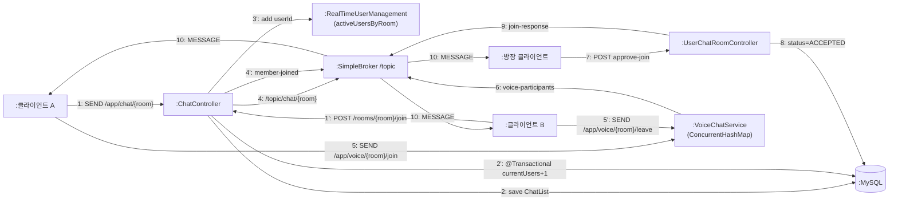

# 6단계. 테스트

> 산출물: 테스트 케이스 시트(TC) · 결함/버그 리포트 · 테스트 결과 요약 · 성능(부하) 테스트 / UML: Communication 다이어그램

## 6.1 테스트 전략

| 수준 | 대상 | 방식 | 현황 |
|---|---|---|---|
| 단위 | Service 로직 | JUnit 5 + Spring Boot Test | ❌ 미작성 (`contextLoads`만 있음) |
| 통합 | REST API + DB | 수동 (Postman/앱) | ✅ 기능 개발 중 수동 확인 |
| 시스템 | 클라이언트 2대 이상 실시간 동작 | 수동 시나리오 | ✅ 시연 준비 시 수행 |
| 회귀 | 병합 후 기존 기능 | 수동 | ⚠️ 체계 없음 → [백로그](07-수정및문서화.md#73-개선-백로그) |
| 성능 | 동시 접속 시 응답 시간·실패율 | k6 부하 테스트 (`loadtest/`) | ✅ 4건 수행 → [6.6](#66-성능부하-테스트) |

테스트 환경

- **기능 테스트** (2026-11-03 ~ 11-18): 운영 NAS 서버가 보안 사고로 중단되어, 팀원 노트북 한 대에서 백엔드(`gradlew bootRun`)와 MySQL 8을 실행했습니다. 다른 클라이언트는 같은 네트워크에서는 IP로, 다른 네트워크(학교 와이파이 등)에서는 Cloudflare Tunnel(`cloudflared`) 주소로 접속했습니다.
- **외부 API**: 게임사 API 키는 만료 상태였으나 2026-11-18 메이플스토리·로스트아크 키를 새로 발급받아 해당 전적 조회를 확인했습니다(LoL·던파는 미발급).
- **성능 테스트** (2026-11-18): 서버 노트북에서 k6로 `localhost`를 직접 호출했습니다(6.6 참고).

## 6.2 테스트 케이스 시트 (TC)

> 기대 결과는 코드 로직에서 도출했고, **결과** 열은 2026-11-03 ~ 11-18 실제 수행 결과입니다.

### 인증 · 계정

| TC | 요구사항 | 시나리오 | 입력 | 기대 결과 | 결과 |
|:--:|:--:|---|---|---|:--:|
| TC-01 | FR-01 | 형식에 맞지 않는 비밀번호로 가입 | `abcd1234` | 400, "대문자·특수문자 포함" 검증 메시지 | Pass |
| TC-02 | FR-01 | 아이디 길이 미달 | `abc` | 400, 4~20자 메시지 | Pass |
| TC-03 | FR-02 | 이미 있는 아이디 중복 확인 | 기존 아이디 | 중복 응답 | Pass |
| TC-04 | FR-03 | 인증 코드 발송 직후 재발송 | 같은 이메일 2회 | 2회째 400 "60초 후 다시 발송" | N/A (로컬 테스트 환경에 메일 계정 미설정 — 운영 당시 사용 기능) |
| TC-05 | FR-03 | 틀린 인증 코드 입력 | 임의 6자리 | 인증 실패 | N/A (로컬 테스트 환경에 메일 계정 미설정 — 운영 당시 사용 기능) |
| TC-06 | FR-04 | 정상 로그인 | 유효 계정 | 200 `{message, sessionId}`, 로비 이동 | Pass |
| TC-07 | FR-04 | 틀린 비밀번호 | – | 401 `로그인 실패` | Pass |
| TC-08 | FR-04 | 자동 로그인 체크 후 앱 재시작 | remember-me | 로그인 화면 없이 로비 진입 | Pass |
| TC-09 | FR-04 | PC-A 로그인 상태에서 PC-B로 같은 계정 로그인 | – | PC-A 세션 만료 | Pass |
| TC-10 | FR-05 | 정지 기간 중 로그인 | SUSPENDED 계정 | 거부, 만료일 안내 | Fail (로그인 차단은 되나 "로그인 실패"만 표시, 정지 사유·만료일 미표시 → BUG-18) |
| TC-11 | FR-05 | 정지 만료일이 지난 뒤 로그인 | – | 로그인 성공, 상태 ACTIVE로 변경 | Pass |
| TC-12 | FR-06 | 이메일 인증 후 비밀번호 재설정 | 새 비밀번호 | 새 비밀번호로 로그인 가능 | N/A (로컬 테스트 환경에 메일 계정 미설정 — 운영 당시 사용 기능) |

### 게임 코드 · 전적

| TC | 요구사항 | 시나리오 | 기대 결과 | 결과 |
|:--:|:--:|---|---|:--:|
| TC-52 | FR-07 | 프로필 이미지 변경 | 새 이미지 저장·표시 | Pass |
| TC-13 | FR-08 | LoL 코드 `이름#태그` 등록 후 대표 지정 | 목록에 대표 표시 | Pass |
| TC-14 | FR-09 | LoL 전적 조회 | 티어·숙련도·최근 매치 표시 | N/A (API 키 만료) |
| TC-15 | FR-09 | 존재하지 않는 캐릭터명으로 메이플 조회 | 오류 안내, 앱 정상 동작 | Pass ("메이플 정보가 없습니다", "정보를 불러오는 중 오류가 발생했습니다" 안내 표시, 앱 정상 동작) |
| TC-16 | NFR-02 | 같은 캐릭터 1시간 내 재조회 | 캐시 응답(외부 API 미호출, 응답 빨라짐) | Pass (재조회 시 체감상 더 빠름 — 화면 조회 경로 `/maple/api/character`가 `@Cacheable("mapleCache")` 메서드를 거치는 것 코드로 확인, 응답 시간 수치는 미측정) |
| TC-17 | FR-09 | 던파·로스트아크 조회 | 캐릭터 정보 표시 | Pass (로스트아크 캐릭터 정보 표시 확인, 2026-11-18 새 API 키 / 던파는 API 키 만료로 미확인) |

### 채팅방

| TC | 요구사항 | 시나리오 | 기대 결과 | 결과 |
|:--:|:--:|---|---|:--:|
| TC-18 | FR-10 | 인원 1명 또는 21명으로 방 생성 | 400 "2~20명" | Pass |
| TC-19 | FR-10 | 같은 게임에 같은 이름 방 생성 | 409 | Pass (409 응답 확인) |
| TC-20 | FR-10 | 다른 게임에는 같은 이름 허용 | 생성 성공 | Pass |
| TC-21 | FR-10 | 해당 게임 코드 없이 방 생성 | 400 "게임 코드를 먼저 등록" | Pass |
| TC-22 | FR-10 | 정상 생성 | 방장 입장, 운영 유의사항 메시지 표시 | Pass |
| TC-23 | FR-11 | 게임 + 태그 + 키워드 검색 | 조건에 맞는 방만 표시 | Pass |
| TC-24 | FR-12 | 자유 입장 방 입장 | 즉시 입장, 입장 메시지, 인원 +1 | Pass |
| TC-25 | FR-13 | 정원이 찬 방 입장 | 403 room is full | Pass |
| TC-26 | FR-13 | 이미 참여한 방 재입장 | 409 already joined | Pass (참여 중인 방은 검색 목록에 표시되지 않아 UI상 재입장 불가) |
| TC-27 | FR-12 | 승인 방 신청 → 방장 승인 | 방장에게 실시간 알림, 승인 시 신청자 자동 입장 | Pass |
| TC-28 | FR-12 | 승인 방 신청 → 방장 거절 | 신청자에게 거절 알림 | Pass |
| TC-29 | FR-14 | 방장이 멤버 강퇴 | 대상자 화면에서 방 제거, 인원 −1 | Pass |
| TC-30 | FR-14 | 방장 위임 | 새 방장에게 권한 메뉴 표시 | Pass |
| TC-31 | FR-14 | 방 설정 변경 | 다른 참여자 화면에 즉시 반영 | Pass |
| TC-51 | FR-12 | 참여 중인 방에서 나가기 | 내 방 목록에서 제거, 인원 −1, 다른 참여자에게 퇴장 반영 | Pass |

### 메시지 · 친구

| TC | 요구사항 | 시나리오 | 기대 결과 | 결과 |
|:--:|:--:|---|---|:--:|
| TC-32 | FR-15 | 텍스트 메시지 전송 (PC 2대) | 1초 이내 상대 화면 표시, 재입장 시 이력 유지 | Pass (텍스트·이미지·이모지) |
| TC-33 | FR-15 | 10MB 초과 이미지 / 이미지가 아닌 파일 | 업로드 거부 | Pass |
| TC-34 | FR-16 | 메시지 고정 · 삭제 | 모든 참여자 화면에 반영 | Pass |
| TC-35 | FR-17 | 다른 방에 있을 때 메시지 수신 | 방 목록에 미확인 수 증가 | Pass |
| TC-36 | FR-18 | 친구 요청 → 수락 | 요청 수 배지, 수락 후 양쪽 친구 목록 | Pass |
| TC-37 | FR-18 | 차단 후 친구 요청 | 요청 불가 | Pass |
| TC-38 | FR-19 | 1:1 메시지 | 실시간 송수신, 미확인 수 | Pass |
| TC-39 | FR-20 | 친구를 채팅방에 초대 → 수락 | 초대 모달 표시, 수락 시 입장 | Pass |

### 음성 · 상태 · 관리

| TC | 요구사항 | 시나리오 | 기대 결과 | 결과 |
|:--:|:--:|---|---|:--:|
| TC-40 | FR-21 | 음성 채널 생성 · 입장 (PC 2대) | 서로 목소리 들림, 참여자 목록에 닉네임 표시 | Pass (2026-11-18 동기 노트북과 양방향 음성·참여자 목록 확인) |
| TC-41 | FR-21 | 말할 때 | 발화 표시(테두리 등) | Pass |
| TC-42 | FR-21 | 음소거 | 상대에게 소리 전달 안 됨 | Pass |
| TC-43 | FR-21 | 음성 채널 삭제 | 참여자 퇴장, 목록에서 제거 | Pass |
| TC-44 | FR-22 | 10초간 입력 없음 | 친구 화면에 자리비움 | Pass |
| TC-45 | FR-22 | 앱 강제 종료 | 친구 화면에 오프라인 | Pass (테스트 중 앱이 예기치 않게 종료된 상황에서 상대 화면에 오프라인 표시 확인) |
| TC-46 | FR-23 | 리그 오브 레전드 클라이언트 실행 | 10초 내 친구 화면에 게임 중 표시 | Pass (리그 오브 레전드 클라이언트 실행 시 상대 화면에 게임 중 표시) |
| TC-47 | FR-24 | 이미지 첨부해 신고 | 관리자 신고 목록에 표시(PENDING) | Pass |
| TC-48 | FR-26 | 관리자가 3일 정지 | 대상자 즉시 로그아웃·음성 퇴장, 재로그인 거부 | Pass |
| TC-49 | NFR-04 | 일반 계정으로 `/api/admin/users` 호출 | 403 | Pass |
| TC-50 | FR-25 | 방 채팅 로그 조회 | 해당 방 메시지 시간순 표시 | Pass |

## 6.3 결함 / 버그 리포트

git 커밋 이력에서 확인되는 주요 결함과 조치입니다(2025-10 ~ 11, 릴리스 전 안정화 기간).

| ID | 발견 영역 | 증상 | 원인·조치 | 수정 커밋 일자 / 커밋 작성자(GitHub) |
|:--:|---|---|---|---|
| BUG-01 | 인증 | 패키징된 앱에서 로그인 세션이 유지되지 않음 | `app://` 출처라 쿠키 미전송 → Electron에서 `Set-Cookie` 보정·수동 주입 | 2025-11-01 / `MianShang` |
| BUG-02 | 인증 | 자동 로그인이 동작하지 않음 | remember-me 토큰·쿠키 만료 처리 수정 | 2025-11-13 / `siuuugil` |
| BUG-03 | 인증 | 프로필을 열고 닫으면 관리자 권한이 사라짐 | 사용자 정보 갱신 시 권한 값 유실 | 2025-10-14 / `siuuugil` |
| BUG-04 | 음성 | 자동 로그아웃 후에도 통화가 유지됨, 재로그인 시 구독 누락 | 로그아웃 시 음성 퇴장, 재로그인 시 STOMP 재구독 | 2025-11-18 / `gaeuns` |
| BUG-05 | 음성 | 참여자 목록이 실시간으로 갱신되지 않음 | 음성 참여자 WebSocket 브로드캐스트 수정 | 2025-10-12 / `gaeuns` |
| BUG-06 | 음성 | 1:1 음성 채팅 오류 | 채널명·참여자 처리 수정 | 2025-10-14 / `gaeuns` |
| BUG-07 | 음성 | 음성 UI 드래그 시 채팅방으로 이동됨 | 드래그 이벤트 전파 차단 | 2025-10-24 / `gaeuns` |
| BUG-08 | 채팅방 | 초대받아 입장한 방이 다른 방 이동 시 목록에서 사라짐 | 참여 상태 처리 수정 | 2025-10-14 / `Yongb15` |
| BUG-09 | 채팅방 | 방 인원 수가 실제와 다름 | 입장·퇴장 시 `currentUsers` 계산 수정 | 2025-11-18 / `Yongb15` |
| BUG-10 | 채팅방 | 같은 방이 중복 생성됨, 설정 변경이 실시간 반영 안 됨 | 이름 중복 검사(409) + 설정 변경 브로드캐스트 | 2025-10-12 / `Yongb15` |
| BUG-11 | 채팅 | 안 읽은 메시지 수가 맞지 않음 | 읽음 처리 로직 수정 | 2025-10-31, 11-03 / `Yongb15` |
| BUG-12 | 친구 채팅 | 메시지 삭제가 화면에 바로 반영되지 않음 | 삭제 결과 브로드캐스트 후 UI 갱신 | 2025-10-26 / `Yongb15` |
| BUG-13 | 친구 | 친구 상태가 잘못 표시됨, 로그아웃 상태 미반영 | 상태 전파 로직 수정 | 2025-10-27 / `Limsungyong`, 11-10 / `MianShang` |
| BUG-14 | 이미지 | 검색 페이지·친구 프로필 이미지가 깨짐 | 이미지 경로·정적 리소스 매핑 수정 | 2025-11-02, 11-03, 11-10 / `MianShang` |
| BUG-15 | 프로필 | 대표 캐릭터 설정·전적 조회 불러오기 오류 | 대표 계정 조회 로직 수정 | 2025-10-15 / `siuuugil` |
| BUG-16 | 음성 | 채널 생성 시 이름 중복·입력 오류 표시 없음 | 입력 검증·중복 방지 추가 | 2025-10-29 / `gaeuns` |
| BUG-17 | 배포 | 프론트 배포 파일 버전 오류 | 빌드 설정 수정 | 2025-10-28 / `MianShang` |
| BUG-18 | 인증 | 정지된 계정으로 로그인하면 "로그인 실패"만 표시되고 정지 사유·만료일이 안 보임 | 로그인 실패 핸들러가 예외 메시지를 버리고 항상 같은 응답을 보냄, 프론트도 고정 문구만 표시 → **미조치** (백로그 BL-26) | 2026-11-16 테스트 중 발견 |
| BUG-19 | 음성 | 마이크가 없는 PC에서 음성 채널 입장 시 참여자 목록에 안 뜨는데 상대 목소리는 들림 | `VoiceChat.jsx`가 Agora 채널 입장 후 마이크 트랙 생성에서 `DEVICE_NOT_FOUND`로 실패하면, 서버 입장 알림(`/app/voice/{roomId}/join`)을 보내지 않고 Agora 채널에서도 나가지 않음 → 목록엔 없고 소리만 듣는 상태, 사용자에게 오류 안내 없음 → **미조치** (백로그 BL-27) | 2026-11-16 테스트 중 발견 |
| BUG-20 | 성능 | 동시 약 270명이 채팅하면 메시지 DB 저장이 멈추고 30초 뒤 실패 (PT-04) | `ChatList`·`ChatIsRead`의 ID 생성 방식(AUTO → 시퀀스 테이블)이 저장 중에 커넥션을 하나 더 요구해 커넥션 풀(10개)이 교착 → **미조치** (백로그 BL-29) | 2026-11-18 부하 테스트 중 발견 |

## 6.4 Communication 다이어그램 — 동시성 점검

여러 클라이언트가 같은 방에 동시에 이벤트를 보낼 때의 객체 협업입니다. Mermaid에는 Communication 전용 문법이 없어 번호가 붙은 메시지 흐름으로 표현했습니다.



### 점검 결과

| # | 지점 | 위험 | 현재 처리 |
|:--:|---|---|---|
| C1 | 마지막 1자리에 두 명이 동시에 자유 입장 | 정원 초과 | `@Transactional`이지만 비관/낙관 락이 없어 동시 요청 시 초과 가능 → 개선 필요 |
| C2 | 음성 입장·퇴장 동시 발생 | 참여자 목록 불일치 | `ConcurrentHashMap`으로 맵 자체는 안전, 브로드캐스트 순서는 보장 안 됨 |
| C3 | 같은 이메일로 인증 코드 동시 발송 | 코드 중복 발송 | 이메일별 `ReentrantLock` + 60초 제한으로 방지 |
| C4 | 같은 방 이름 동시 생성 | 중복 방 | 선 검사 + DB `UNIQUE(name, gameName)`로 최종 차단 |
| C5 | 같은 사용자 중복 참여 요청 | 참여 레코드 중복 | DB `UNIQUE(user_id, chat_room_id)` |

## 6.5 테스트 결과 요약

| 항목 | 값 |
|---|---|
| 총 TC | 52 |
| Pass / Fail / N/A | **47 / 1 / 4** (전체 수행 완료) |
| 수행 기간 | 2026-11-03 ~ 2026-11-18 |
| 발견 결함 (6.3) | 20건 — 17건 조치 완료, 3건 미조치(BUG-18, BUG-19, BUG-20) |
| 미해결 이슈 | [07 백로그](07-수정및문서화.md#73-개선-백로그) 참고 |
| 성능 테스트 (6.6) | 4건 — REST 1,000명 실패 0% (p95 566ms), 실시간 채팅 300명 전달 p95 59ms, DB 저장은 약 270명에서 커넥션 풀 교착(BUG-20) |
| 코드 커버리지 | 측정 안 함 (단위 테스트 없음) |

## 6.6 성능(부하) 테스트

[k6](https://k6.io)로 가짜 사용자를 늘려 가며 서버가 버티는지 확인했습니다. 스크립트와 실행 방법은 [`loadtest/`](../loadtest/README.md)에 있습니다.

### 테스트 환경

| 항목 | 내용 |
|---|---|
| 일시 | 2026-11-18 |
| 서버 | 팀원 노트북 1대 — Spring Boot + MySQL 8 (로컬) |
| 부하 발생 | 같은 노트북에서 k6 실행, `localhost:8080` 직접 호출 (터널 미경유) |
| 제외 | 외부 게임 API(호출 제한), 로그인(BCrypt 연산) |

### PT-01 REST API 조회 부하 (`loadtest/rest.js`)

동시 사용자 20 → 50 → 100 → 200명으로 3분 30초 동안 늘려 가며, 사용자마다 1초 간격으로 방 목록·게임 태그·내 방 목록·친구 목록 4개 API를 반복 호출했습니다.

| 지표 | 기준 | 결과 | 판정 |
|---|---|---|:--:|
| 최대 동시 사용자 | – | 200명 | |
| 총 요청 수 | – | 56,060건 (초당 약 266건) | |
| 실패율 | 1% 미만 | **0.00%** (0 / 56,060) | ✅ |
| 응답 시간 p95 | 500ms 이하 | **16.21ms** | ✅ |
| 응답 시간 평균 / 중앙값 | – | 6.89ms / 5.49ms | |
| 응답 시간 최대 | – | 137.05ms | |

**해석**: 동시 사용자 200명에서도 실패 없이 95% 요청이 약 16ms 안에 응답해, 졸업작품 규모(수십 명 동시 접속)에서는 조회 API가 병목이 되지 않습니다. 다만 서버와 부하 도구가 같은 노트북에서 돌았고, 테스트 DB의 데이터가 적으며, 조회 API만 대상으로 했으므로 한계점(서버가 무너지는 지점)까지는 확인하지 않았습니다.

### PT-02 실시간 채팅 부하 (`loadtest/chat.js`)

동시 접속자 20 → 50 → 100명이 같은 방을 구독하고 2초마다 메시지를 보내 전달 지연을 측정합니다.

| 지표 | 기준 | 결과 | 판정 |
|---|---|---|:--:|
| 최대 동시 접속 | – | 100명 (WebSocket 세션 총 184개) | |
| 보낸 메시지 | – | 4,948건 (초당 약 26건, 최대 구간 초당 50건) | |
| 받은 메시지 (전체 접속자 합계) | – | 346,040건 (초당 약 1,837건) | |
| 전달 지연 p95 (`chat_delivery_ms`) | 1000ms 이하 | **50ms** | ✅ |
| 전달 지연 평균 / 중앙값 / 최대 | – | 16.67ms / 10ms / 134ms | |
| WebSocket 연결 시간 p95 | 1000ms 이하 | **33.72ms** | ✅ |
| WebSocket 연결 성공률 | – | 100% (완료된 세션 126개 기준) | |

**해석**: 한 방에 100명이 동시에 접속해 2초마다 메시지를 보내는 상황(서버가 초당 약 1,800건을 각 접속자에게 뿌리는 부하)에서도 메시지 95%가 50ms 안에 전달되어, 1단계 KPI "메시지 전달 지연 1초 이내"를 크게 만족했습니다. 별도 메시지 브로커 없이 Spring 내장 Simple Broker로도 졸업작품 규모의 실시간 채팅은 충분히 처리됩니다.

**참고**: 58개 세션이 "interrupted"로 표시된 것은 마지막 감소 구간에서 k6가 60초짜리 세션을 끝까지 기다리지 않고 종료했기 때문이며, 오류가 아닙니다. 서버와 부하 도구가 같은 노트북이므로 실제 인터넷 구간의 지연은 포함되지 않았습니다.

### PT-03 REST API 한계 테스트 (`loadtest/rest.js`, 최대 1,000명)

PT-01과 같은 시나리오를 동시 사용자 100 → 300 → 600 → 1,000명으로 4분 동안 늘려 가며 실행했습니다. 서버 로그는 콘솔 대신 파일(`server.log`)로 출력해 콘솔 출력 지연을 배제했습니다.

```powershell
k6 run --stage 30s:100,1m:300,1m:600,1m:1000,30s:0 -e USER=user1 loadtest/rest.js
```

| 지표 | 기준 | 결과 | 판정 |
|---|---|---|:--:|
| 최대 동시 사용자 | – | 1,000명 | |
| 총 요청 수 | – | 238,112건 (평균 초당 약 989건) | |
| 실패율 | 1% 미만 | **0.00%** | ✅ |
| 응답 시간 p95 | 500ms 이하 | **566.1ms** | ❌ |
| 응답 시간 평균 / 중앙값 / p90 / 최대 | – | 184.75ms / 98.88ms / 484.24ms / 1.73s | |

작업 관리자 CPU 사용률(관찰값)

| 동시 사용자 | `java.exe`(서버) | `mysqld.exe` | `k6.exe` |
|---|---|---|---|
| 400명 | 약 47% | – | – |
| 600명 | 약 57% | – | – |
| 1,000명 | 약 58% (600~1,000명 구간 53~57% 사이 반복) | 약 16% | 약 4% |

**해석**

- **요청 실패는 0건**이었습니다. 1,000명 동시 접속에서도 서버가 죽거나 에러를 내지 않고, 응답이 느려지는 방식으로 버텼습니다.
- **응답 시간 p95가 16ms(200명) → 566ms(1,000명)로 약 35배** 늘어나 기준(500ms)을 넘었습니다.
- 그런데 같은 구간에서 서버 CPU는 **55% 안팎에서 더 오르지 않았습니다.** CPU가 남는데도 처리량이 늘지 않았다는 것은 연산이 아니라 **대기열**이 병목이라는 뜻입니다. 가장 유력한 원인은 Spring Boot 기본 설정인 **Tomcat 작업 스레드 200개**와 **DB 커넥션 풀(HikariCP) 10개**로, 그 이상 들어온 요청은 빈 스레드·커넥션을 기다리며 쌓였습니다.
- 부하 도구(k6)는 CPU 약 4%만 사용해, 측정이 부하 도구의 한계가 아닌 **서버의 한계**를 반영합니다.

**결론**: 기본 설정 그대로 노트북 1대에서 **동시 600명 안팎까지는 쾌적, 1,000명에서는 응답이 느려지지만 실패 없이 처리**합니다. 처리량을 더 올리려면 아래를 조정한 뒤 같은 테스트로 비교할 수 있습니다(개선 백로그 BL-28).

| 설정 | 기본값 | 조정 예 |
|---|---|---|
| `server.tomcat.threads.max` | 200 | 400 |
| `spring.datasource.hikari.maximum-pool-size` | 10 | 20~30 |

### PT-04 실시간 채팅 + DB 저장 한계 테스트 (`loadtest/chat.js`, `SAVE=1`, 최대 300명)

실제 앱처럼 메시지마다 실시간 전송(STOMP)과 DB 저장 API 2개(`/api/user/add/userchatlist`, `/api/chat/isread`)를 함께 호출하며 동시 접속자를 50 → 150 → 300명으로 늘렸습니다. 테스트 방 멤버는 3명(admin, user1, user3)이며 발신자는 user1입니다.

```powershell
k6 run --stage 20s:50,1m:150,1m:300,20s:0 -e ROOM=<방 ID> -e SAVE=1 loadtest/chat.js
```

| 지표 | 기준 | 결과 | 판정 |
|---|---|---|:--:|
| 최대 동시 접속 | – | 300명 | |
| 보낸 메시지 / 받은 메시지 | – | 3,527건 / 336,914건 (초당 약 1,773건) | |
| 실시간 전달 지연 p95 | 1000ms 이하 | **59ms** | ✅ |
| WebSocket 연결 시간 p95 | 1000ms 이하 | 7.48ms | ✅ |
| DB 저장 실패율 | 1% 미만 | **4.58%** (3,378건 중 155건) | ❌ |
| DB 저장 응답 p95 / 평균 / 최대 | 500ms 이하 | 91.95ms / 2.8s / 1분 30초 | ✅(p95) |
| HTTP 요청 실패율 | – | 6.21% (6,901건 중 429건) | |
| HTTP 응답 p95 | – | **30.01s** | |

관찰: 약 270명 구간(시작 후 2분 20초)에서 `java.exe`·`mysqld.exe`·`k6.exe` CPU가 모두 0~1%로 떨어지고, 저장 요청이 60초 타임아웃으로 실패하기 시작했습니다.

**원인 분석 (서버 로그로 확인)**

서버 로그에 아래 오류가 1,810회 기록되었습니다.

```
HikariPool-1 - Connection is not available, request timed out after 30012ms
(total=10, active=10, idle=0, waiting=24)
DataAccessResourceFailureException: unable to obtain isolated JDBC connection
  at org.hibernate.id.enhanced.TableStructure$1.getNextValue(...)
  at org.hibernate.id.enhanced.PooledOptimizer.generate(...)
  at org.hibernate.id.enhanced.SequenceStyleGenerator.generate(...)
```

- `ChatList`, `ChatIsRead` 엔티티의 ID가 `@GeneratedValue`(기본 AUTO)로 되어 있어, MySQL에서는 Hibernate가 **별도 시퀀스 테이블**(`chat_list_seq` 등)로 ID를 발급합니다.
- 이 시퀀스 값을 가져올 때 Hibernate는 현재 트랜잭션과 **분리된 DB 커넥션을 하나 더** 빌립니다(isolated connection).
- 동시 요청이 많아지자 커넥션 10개가 모두 "저장 중"인 요청에 잡힌 상태에서, 그 요청들이 ID 발급용 커넥션을 **하나씩 더** 기다리는 상황이 되었습니다. 서로가 서로를 기다리는 **커넥션 풀 교착(pool deadlock)** 으로, CPU 사용 없이 30초 타임아웃까지 멈춰 있다가 실패했습니다. HTTP 응답 p95가 정확히 **30초**인 것도 이 타임아웃 값과 일치합니다.
- 반면 **실시간 전달은 p95 59ms로 정상**이었습니다. 실시간 전송과 DB 저장이 분리된 구조 덕분에, DB가 멈춘 동안에도 채팅 화면 자체는 계속 동작했습니다. (대신 그 사이 메시지 일부는 DB에 저장되지 않아 새로고침 시 사라질 수 있습니다.)

**결론**: 실시간 채팅은 300명까지 문제없으나, **DB 저장 경로는 동시 약 270명에서 커넥션 풀 교착으로 일시 정지**합니다. 개선 방법은 결함 BUG-20, 백로그 BL-29를 참고합니다.

