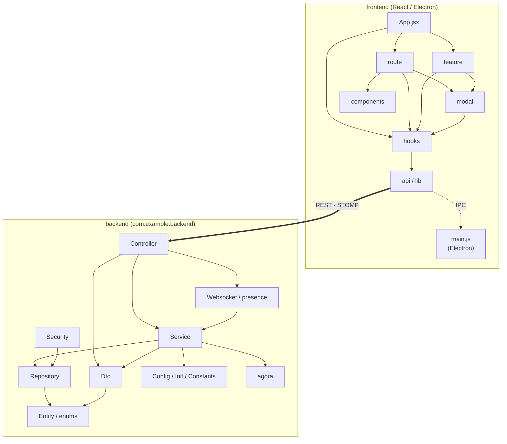

# 7단계. 수정 및 문서화

> 산출물: 운영자 매뉴얼 · 장애 대응 가이드(런북) · 개선 백로그 · 현행화된 아키텍처/API 문서(→ [03](03-설계.md), [04](04-구조생성.md)) / UML: Package 다이어그램

## 7.1 운영자 매뉴얼

### 서버 기동

서버는 팀원 개인 NAS에서 Docker 컨테이너(백엔드, MySQL)로 운영했습니다. 아래 절차는 NAS에 접속한 상태를 기준으로 합니다.

1. MySQL 컨테이너를 기동하고 DB를 만듭니다. 데이터 폴더는 NAS 볼륨에 마운트해 컨테이너를 지워도 남게 합니다. 테이블은 첫 실행 때 JPA가 자동 생성합니다(`ddl-auto=update`).
2. remember-me용 `persistent_logins` 테이블을 만듭니다(자동 생성이 꺼져 있음).

   ```sql
   CREATE TABLE persistent_logins (
     username  VARCHAR(64) NOT NULL,
     series    VARCHAR(64) PRIMARY KEY,
     token     VARCHAR(64) NOT NULL,
     last_used TIMESTAMP   NOT NULL
   );
   ```

3. 백엔드 컨테이너에 환경 변수를 설정합니다([04 › 환경 변수](04-구조생성.md#환경-변수)).
4. 업로드 폴더 `/app/uploads/profile`, `/app/uploads/chat`을 NAS 볼륨으로 마운트합니다.
5. 백엔드 컨테이너를 실행하고 `8080` 포트가 열렸는지, 도메인 주소로 외부에서 접속되는지 확인합니다.

### 관리자 계정

- 아이디가 **`admin`** 인 계정이 자동으로 관리자 권한(`ROLE_ADMIN`)을 받습니다. 일반 가입 절차로 `admin` 아이디를 먼저 만들어 두세요.
- 관리자 로그인 후 `/admin` 화면에서 다음을 할 수 있습니다.

| 기능 | 방법 |
|---|---|
| 사용자 조회 | 사용자 목록 → 상세 (게임 코드, 상태, 정지 만료일) |
| 신고 처리 | 신고 목록(PENDING) → 상세 확인(첨부 이미지) → 정지 일수 입력 → 처리 시 RESOLVED |
| 영구 정지 / 해제 | 사용자 상세에서 영구 정지 또는 활성화 |
| 채팅 로그 | 방 ID로 메시지 이력 조회 |

정지하면 대상자는 즉시 강제 로그아웃되고, 기간이 끝난 뒤 다시 로그인하면 자동으로 활성화됩니다.

### 클라이언트 배포

1. `frontend/.env`의 `VITE_API_URL`을 운영 서버 주소로 바꿉니다.
2. `package.json`의 `version`을 올리고 `npm run dist`를 실행합니다.
3. `dist/QMatch Setup x.x.x.exe`를 GitHub Releases에 올립니다.

### 로그 위치

| 구분 | 위치 |
|---|---|
| 클라이언트 | `%APPDATA%\QMatch\electron-main.log` (메인 프로세스 console 출력 전체) |
| 서버 | `docker logs <백엔드 컨테이너>` |

## 7.2 장애 대응 가이드 (Runbook)

각 런북은 대상·사전 확인·절차·판단 분기·이상 시 대응·완료 확인 순으로 정리했습니다.

### RB-01. 로그인이 안 되거나 로그인 직후 로그아웃됨

| 항목 | 내용 |
|---|---|
| 대상 | 클라이언트 전체 또는 일부 사용자 |
| 사전 확인 | 서버 접속 가능 여부, 해당 계정 상태(관리자 화면) |
| 절차 | ① 계정이 SUSPENDED/BANNED인지 확인 → ② 클라이언트 로그에서 `[webRequest] 쿠키 주입 실패` 검색 → ③ 응답에 `Set-Cookie: JSESSIONID`가 오는지 확인 → ④ 서버 `front_url`과 CORS 허용 출처 확인 |
| 판단 분기 | 한 사용자만 → 계정 상태나 중복 로그인(다른 PC 로그인 시 기존 세션 만료) / 전체 → 서버·CORS·쿠키 설정 |
| 이상 시 대응 | 사용자에게 `%APPDATA%\QMatch` 폴더 삭제 후 재로그인 안내, 해결 안 되면 로그 파일을 받아 담당자(인증: 김수길, Electron: 오승호)에게 전달 |
| 완료 확인 | 로그인 후 `/api/check-login`이 로그인 상태 반환 |

### RB-02. 메시지·알림이 실시간으로 오지 않음

| 항목 | 내용 |
|---|---|
| 대상 | 채팅, 친구 상태, 입장 신청 알림 |
| 사전 확인 | NAS 전원·네트워크 상태, 서버 기동 여부, `/gs-guide-websocket/info` 응답 |
| 절차 | ① 개발자 도구에서 SockJS 연결 상태 확인 → ② 끊겼다면 5초 자동 재연결 대기 → ③ 재연결 후에도 안 오면 재로그인(구독 재등록) → ④ 서버 로그에서 `SessionDisconnectEvent` 반복 여부 확인 |
| 판단 분기 | 메시지는 저장되는데 화면에만 안 보임 → 클라이언트 구독 문제 / 저장도 안 됨 → 서버·DB 문제 |
| 이상 시 대응 | 서버 재시작. 이때 접속 사용자·음성 참여자 목록(메모리)은 초기화된다는 점을 공지 |
| 완료 확인 | PC 2대로 메시지를 주고받아 1초 이내 표시 |

### RB-03. 음성 채팅이 연결되지 않거나 소리가 안 들림

| 항목 | 내용 |
|---|---|
| 대상 | 음성 채널 |
| 사전 확인 | Agora 콘솔 사용량·프로젝트 상태, `agora_id`·`agora_certificate`·`VITE_AGORA_APP_ID`가 같은 프로젝트인지 |
| 절차 | ① `/agora/token` 응답에 토큰이 오는지 → ② 마이크 권한·장치 선택(음성 설정 모달) → ③ 음소거 상태 확인 → ④ 방화벽·회사망에서 Agora UDP 포트 차단 여부 |
| 판단 분기 | 토큰 발급 실패 → 서버 환경 변수 / 입장은 되는데 소리 없음 → 장치·음소거·네트워크 |
| 이상 시 대응 | 채널 나갔다 재입장, 앱 재시작. 참여자 목록만 어긋나면 서버의 메모리 맵 문제이므로 해당 사용자 재입장 |
| 완료 확인 | 두 사용자가 서로 목소리를 듣고 발화 표시가 보임 |

### RB-04. 전적 조회 실패

| 항목 | 내용 |
|---|---|
| 대상 | LoL / 메이플 / 던파 / 로스트아크 |
| 사전 확인 | 각 게임사 API 키 만료 여부 (특히 Riot 개발 키는 24시간마다 만료) |
| 절차 | ① 서버 로그에서 401/403(키), 429(호출 제한), 404(캐릭터 없음) 구분 → ② 키 갱신 후 환경 변수 교체·재시작 → ③ 429면 캐시가 차는 동안 대기 |
| 판단 분기 | 특정 게임만 실패 → 해당 API 키·외부 장애 / 전체 실패 → 서버 네트워크 |
| 이상 시 대응 | 게임사 개발자 포털 공지 확인, 담당자(LoL: 김용빈, 메이플: 임성용, 던파: 김수길, 로아: 임지섭)에게 전달 |
| 완료 확인 | 프로필 전적 모달 정상 표시 |

### RB-05. 이메일 인증 코드가 오지 않음

| 항목 | 내용 |
|---|---|
| 사전 확인 | `spring.mail.username/password`(Gmail 앱 비밀번호), 스팸함 |
| 절차 | ① 서버 로그에서 SMTP 인증 오류 확인 → ② 60초 재발송 제한 안내 → ③ Gmail 일일 발송 한도 확인 |
| 이상 시 대응 | 앱 비밀번호 재발급 후 재시작. 재시작하면 발송된 인증 코드(메모리 저장)는 모두 무효가 되므로 다시 받도록 안내 |
| 완료 확인 | 인증 메일 수신, 코드 확인 성공 |

### RB-06. 디스크 부족 · 이미지 업로드 실패

| 항목 | 내용 |
|---|---|
| 사전 확인 | NAS 저장 공간, `/app/uploads` 용량, 쓰기 권한 |
| 절차 | ① `df -h`로 확인 → ② 탈퇴·삭제된 방의 이미지 정리 → ③ 권한 오류면 `chown`/`chmod` |
| 완료 확인 | 채팅 이미지 업로드·표시 정상 |

### RB-07. 서버 전체에 접속이 안 됨 (NAS)

| 항목 | 내용 |
|---|---|
| 대상 | 모든 사용자 (로그인 화면에서 응답 없음) |
| 사전 확인 | NAS 관리자 계정·접속 방법 |
| 절차 | ① NAS 전원·인터넷 연결 확인 → ② `docker ps`로 백엔드·MySQL 컨테이너 실행 여부 확인(재부팅 후 자동 시작 안 됐으면 `docker start`) → ③ `nslookup <도메인>`으로 도메인이 NAS의 현재 공인 IP를 가리키는지 확인 → ④ 클라이언트 `VITE_API_URL`과 실제 주소가 같은지 확인 |
| 판단 분기 | 내부망에서는 되고 외부에서 안 됨 → DNS 레코드·공인 IP 변경·공유기 설정 / 내부망에서도 안 됨 → NAS·백엔드 프로세스 |
| 이상 시 대응 | NAS 소유자에게 연락. IP가 바뀌었으면 DNS 레코드만 갱신(도메인을 쓰므로 클라이언트 재배포 불필요), 도메인 자체가 바뀌었으면 `VITE_API_URL` 수정 후 재배포 |
| 완료 확인 | 외부망에서 로그인 성공 |

## 7.3 개선 백로그

코드 검토 중 발견한 기술 부채와 개선 과제입니다. 우선순위는 H(높음)·M(중간)·L(낮음)입니다.

### 보안

| ID | 우선순위 | 항목 | 현재 | 개선안 |
|:--:|:--:|---|---|---|
| BL-01 | H | remember-me 키가 코드에 고정됨 | `SecurityConfig`에 리터럴 문자열 | 환경 변수로 분리하고 키 교체 |
| BL-02 | H | 관리자 판별이 아이디 문자열 비교 | `userId.equals("admin")` | DB에 역할(Role) 컬럼 추가 |
| BL-03 | H | Electron 보안 설정 | `nodeIntegration: true`, `contextIsolation: false`, `allowRunningInsecureContent: true` | preload + `contextBridge`로 IPC만 노출 |
| BL-04 | H | 대부분의 API가 `permitAll`이고 `userId`를 요청 값으로 받음 | 다른 사람 `userId`로 요청 가능 | 서버에서 `Authentication`으로 사용자 확인 |
| BL-05 | M | HTTP 통신, `Secure` 쿠키 미사용 | `useSecureCookie(false)` | HTTPS 적용 후 `Secure`, `SameSite=None` |
| BL-06 | M | CSRF 비활성, WebSocket `setAllowedOriginPatterns("*")` | – | 허용 출처 제한, STOMP CONNECT 시 인증 확인 |
| BL-07 | M | 업로드 파일명이 `타임스탬프_원본파일명` | 원본명에 경로 문자 포함 가능 | UUID 파일명 + 확장자 화이트리스트 |

### 안정성 · 정확성

| ID | 우선순위 | 항목 | 현재 | 개선안 |
|:--:|:--:|---|---|---|
| BL-08 | H | 방 검색에서 `gametag` 없이 호출하면 NPE | `gametag.equals("ALL")` | `"ALL".equals(gametag)` 또는 기본값 지정 |
| BL-09 | M | 정원 초과 경합 (6.4 C1) | 락 없음 | `@Lock(PESSIMISTIC_WRITE)` 또는 조건부 UPDATE |
| BL-10 | M | 음성 참여자·접속자·인증 코드가 메모리에만 있음 | 재시작 시 초기화 | Redis 등 외부 저장소 |
| BL-11 | M | `FriendShipChatReadStatus` 유니크 제약 컬럼명 불일치 | 제약은 `chat_room_id`, 조인 컬럼은 `chatroom_id` | 컬럼명 통일 후 실제 제약 생성 여부 확인 |
| BL-12 | L | `ddl-auto=update` 운영 사용 | 스키마 변경 이력 없음 | Flyway 마이그레이션 |
| BL-13 | L | 구버전 입장 승인 API 중복 (`/apply`·`/accept` vs `/join-request`·`/approve-join`) | 두 흐름 공존 | 사용하지 않는 쪽 제거 |
| BL-23 | M | 개인 NAS 단일 서버 | 전원·회선 장애 시 전체 중단, 백업 체계 불명 | DB 정기 백업(`docker exec mysqldump`), 컨테이너 재시작 정책 `--restart unless-stopped`, 장기 운영 시 클라우드 이전 검토 |

### 품질 · 프로세스

| ID | 우선순위 | 항목 | 개선안 |
|:--:|:--:|---|---|
| BL-14 | H | 단위·통합 테스트 없음 | Service 단위 테스트(JUnit + Mockito), `@SpringBootTest` + Testcontainers(MySQL) |
| BL-15 | M | CI/CD 없음 | GitHub Actions: PR마다 `./gradlew test`, `npm run build` / 태그 시 `electron-builder`로 Release 자동 업로드 |
| BL-16 | M | API 문서가 수동 | springdoc-openapi로 Swagger UI 자동 생성 |
| BL-17 | L | 이름 규칙 불일치 | `userProfileController` → `UserProfileController`, `dropDownPotal` → `DropdownPortal`, `userBlock.js` → `useBlock.js` |
| BL-18 | L | `System.err.println` 로그 | SLF4J 로거로 통일 |
| BL-24 | M | 화면이 다시 그려질 때마다 STOMP 구독 전체를 해제 후 재구독 | 구독 effect의 의존성(`userData` 객체 등)이 렌더마다 바뀌어 같은 토픽을 반복 구독, 그 사이 메시지 누락 가능 | 의존성을 `userId` 같은 원시값으로 좁히고, 이미 구독 중인 ID는 건너뛰기 |
| BL-25 | L | 개발용 `console.log` 과다 | 구독·권한 확인 로그가 렌더마다 출력 | 로그 레벨 분리, 배포 빌드에서 제거 |
| BL-26 | M | 로그인 실패 사유가 표시되지 않음 (BUG-18) | `failureHandler`가 항상 `로그인 실패`만 응답, 정지 계정의 `DisabledException` 메시지가 버려짐 | 실패 핸들러에서 `exception.getMessage()`를 응답에 담고, 프론트에서 `err.response.data.message`를 토스트로 표시 |
| BL-27 | M | 마이크 없을 때 음성 입장이 반쯤만 됨 (BUG-19) | 마이크 트랙 생성 실패 시 Agora 채널에 남은 채 서버 알림 없음 | 실패 시 `client.leave()`로 정리하고 "마이크를 찾을 수 없습니다" 안내, 또는 마이크 없이 듣기 전용으로 입장하고 서버에도 알림 |
| BL-28 | L | 동시 1,000명에서 응답 지연 증가 (PT-03) | Tomcat 스레드 200·DB 커넥션 풀 10 기본값에서 대기열 발생, CPU는 약 55%에서 정체 | `server.tomcat.threads.max`, `spring.datasource.hikari.maximum-pool-size` 조정 후 PT-03 재측정 |
| BL-29 | H | 채팅 저장 시 커넥션 풀 교착 (BUG-20, PT-04) | `@GeneratedValue`(AUTO)가 MySQL에서 시퀀스 테이블 방식으로 동작해 ID 발급 때마다(블록 단위) 별도 커넥션 필요 | 자주 저장되는 엔티티(`ChatList`, `ChatIsRead` 등)를 `@GeneratedValue(strategy = GenerationType.IDENTITY)`로 바꾸고 해당 테이블 `id`를 `AUTO_INCREMENT`로 변경(`ddl-auto=update`는 기존 컬럼을 바꾸지 않으므로 `ALTER TABLE` 필요). 보조로 커넥션 풀 크기 상향 후 PT-04 재측정 |
| BL-19 | L | 버전 표기 불일치 | README `0.0.7`, `package.json` `0.0.6`, Gradle `qmatch-0.0.23` → 하나로 관리 |

### 기능 확장

| ID | 항목 |
|:--:|---|
| BL-20 | 오버워치·발로란트·TFT 연동 (아이콘 리소스는 이미 있음) |
| BL-21 | 티어·포지션 기반 자동 매칭 추천 |
| BL-22 | 웹 버전 (게임 감지 제외 기능만) |

## 7.4 Package 다이어그램



**의존성 요약**: 백엔드는 `Controller → Service → Repository → Entity` 단방향 계층을 지킵니다. 다만 일부 Controller(`ChatController`, `UserChatRoomController`)가 Repository와 `SimpMessagingTemplate`을 직접 호출해 비즈니스 로직이 Controller에 섞여 있습니다. 이 로직을 Service로 옮기면 결합도가 낮아지고 테스트하기 쉬워집니다.

## 7.5 문서 현행화 규칙

| 변경 | 같이 고칠 문서 |
|---|---|
| 엔드포인트 추가·변경 | [03 › API 명세](03-설계.md#32-api-명세서) |
| STOMP 토픽 추가 | [03 › WebSocket 명세](03-설계.md#33-websocketstomp-메시지-명세) |
| 엔티티 필드 변경 | [03 › ERD](03-설계.md#31-erd), [05 › State](05-구현.md#53-state-다이어그램) |
| 환경 변수 추가 | [04 › 환경 변수](04-구조생성.md#환경-변수), 7.1 |
| 버그 수정 | [06 › 결함 리포트](06-테스트.md#63-결함--버그-리포트) |
| 백로그 처리 | 7.3에서 해당 행 삭제 또는 ✅ 표시 |
